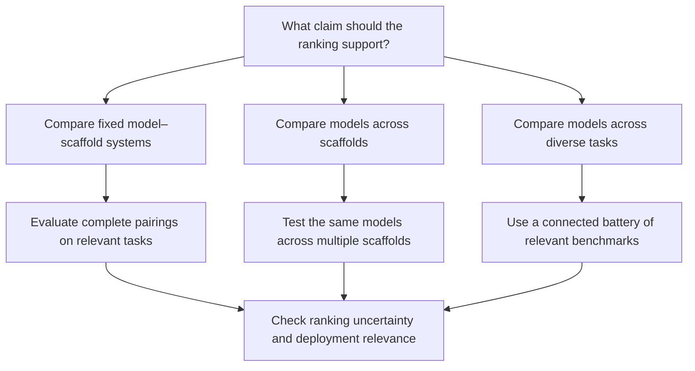

## 🔍 The new result

A [Stanford/UIUC preprint](https://arxiv.org/abs/2610.00651) submitted September 30 quantifies a problem with interpreting agent leaderboards: a ranking that reliably distinguishes complete systems may provide much weaker evidence about the underlying models.

The distinction matters whenever a system-level result becomes a model-selection argument. A model running inside one scaffold—the software that manages tools, state, and actions—is a different object of evaluation from that model’s performance across scaffolds.

The authors—Michael Hardy, Ruhana Azam, Anka Reuel, Mykel Kochenderfer, and Sanmi Koyejo—apply established generalizability theory through a Bayesian variance-decomposition framework designed for sparse, imbalanced agent evaluations. Their analysis covers nine benchmarks from the Holistic Agent Leaderboard (HAL), with a complementary analysis of 13 benchmarks from the Harbor Index.

The framework separates performance differences relevant to the intended claim from variation that can change the ranking without supporting that claim. Model–scaffold compatibility, for example, is useful signal when selecting a complete system. It becomes a source of uncertainty when trying to compare models independently of their scaffolds.

## ⚙️ What the numbers actually say

Across the nine HAL benchmarks, estimated reliability for ranking fixed model–scaffold systems ranges from **0.935 to 0.994**. Reliability for ranking the underlying models, averaging over scaffolds, ranges from **0.148 to 0.841**.

These are generalizability coefficients, written as Eρ². They describe the share of modeled variation attributable to the intended signal. They are estimated on a latent log-odds scale; a coefficient of 0.94 does **not** mean a particular rank has a 94% probability of being correct.

The practical distinction is straightforward. A leaderboard may consistently distinguish the evaluated model–scaffold pairings while leaving substantial uncertainty about which model would remain strongest across different scaffolds.

That does not establish that a highly ranked pairing is a good product. Stable comparisons on benchmark-like tasks do not establish production suitability, safety, or transfer to an enterprise workflow. The paper explicitly separates reliability from validity: an evaluation can be consistent while measuring something different from what a buyer needs.

## 🧮 Why more tasks can leave the central uncertainty intact

Adding tasks can reduce uncertainty associated with which tasks were sampled. It cannot, by itself, eliminate uncertainty associated with model–scaffold compatibility when scaffold coverage stays fixed.

Under the study’s observed scaffold coverage, the estimated improvement from infinitely many similarly constructed tasks is at most **0.097** in model-ranking reliability. The existence of a task-only ceiling follows from the framework; its numerical size depends on the estimated variance components and sampled conditions.

The conclusion is therefore conditional: more tasks can help, but their benefit can be small when the main unresolved question concerns scaffolds. The ceiling is not a universal constant for agent evaluation, and “more tasks do nothing” would overstate the result.

This complements [The Evaluation Stack Is Breaking in Three Places at Once](https://minwu-ai.github.io/the-evaluation-stack-is-breaking-in-three-places-at-once/), which discussed benchmark saturation alongside measurement and external-validity problems. Saturation and scaffold sensitivity are distinct issues. A benchmark can retain difficult tasks while still providing limited evidence about model differences across scaffolds.

## 🧩 Match the additional testing to the claim

The paper recommends testing the same models across multiple scaffolds when the goal is to isolate model differences. For claims about performance across different kinds of agentic tasks, it also examines pooling diverse benchmarks.

Two projections should be kept separate:

- **At the same task budget**, distributing evaluation across the nine-benchmark HAL battery raises projected cross-task model-ranking reliability from approximately **0.44 to 0.75**.
- **For an illustrative reliability target of approximately 0.71**, a smaller allocation across that battery costs an estimated **$8,144**, about **83% less** than the full HAL battery.

These are model-based design projections, not measured savings from a production rollout. Benchmark breadth also requires relevant tasks and enough shared models and scaffolds to connect the comparisons. Adding arbitrary benchmarks is not automatically better evaluation, as the paper's [methods and scope conditions](https://arxiv.org/html/2610.00651v1) make clear.

## 🧭 Where this sits against prior coverage

[Scale AI’s READY framework](https://minwu-ai.github.io/scale-ai-s-ready-framework-asks-the-question-leaderboards-ca/) highlighted how near-tied accuracy scores can imply different human-review burdens under a specified oversight policy. [Princeton’s reliability scorecard](https://minwu-ai.github.io/the-reliability-gap-your-agent-passed-the-benchmark/) reported that reliability improved more slowly than accuracy across roughly two years of model releases, with little improvement on open-ended tasks.

Those uses of “reliability” concern operating behavior and oversight. This paper focuses on comparative measurement: which model or system differences a ranking can consistently distinguish across specified evaluation conditions.

Its contribution is a framework for diagnosing which sources of variation limit that comparison—and projecting which additional evaluations could help.

## 🧱 The governance implication

For procurement and model selection, my reading is that every cited leaderboard result should come with an explicit statement of what it supports.

| Intended claim | Evidence needed |
|---|---|
| “This model–scaffold pairing ranks above the alternatives on these tasks” | Comparisons of complete systems, with ranking uncertainty reported |
| “This model performs better across scaffolds” | The same models tested across multiple relevant scaffolds |
| “This model performs better across different kinds of agentic tasks” | A connected, relevant benchmark battery, with uncertainty assessed |
| “This system is suitable for our workflow” | Validation against the organization’s tasks, constraints, costs, and failure consequences |

A HAL or Harbor rank can inform a shortlist. Using it to predict a model swap inside your own harness requires additional evidence. The procurement question is: **does this comparison evaluate the system we intend to deploy, under conditions that matter to us?**
