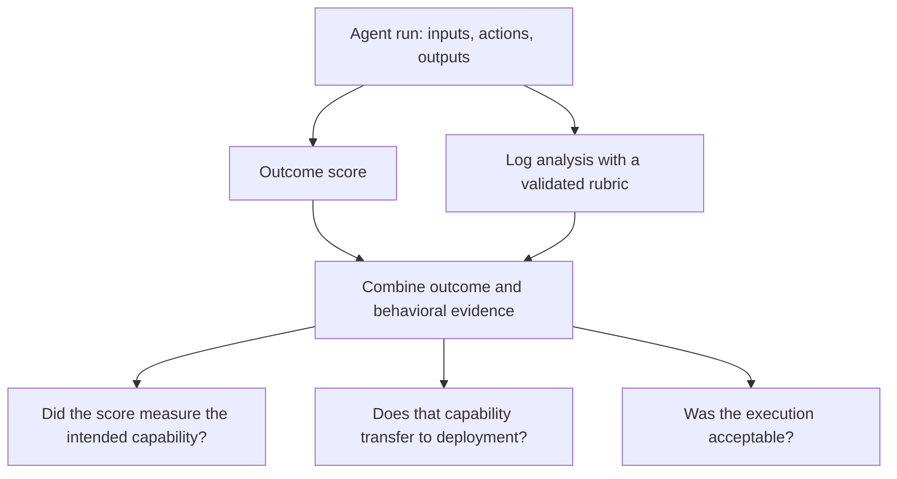

## 🔍 The problem outcome scores can't name

A benchmark score is a verdict without a transcript. It tells you whether an agent satisfied the grader, while leaving questions about how the agent reached that outcome.

An earlier piece on this site, [Same Benchmark Score, Four Times the Risk](https://minwu-ai.github.io/pass-fail-was-never-going-to-catch-this-a-princeton-aisi-apo/), examined research on τ-Bench Airline showing how flawed tasks suppressed measured performance and similar scores concealed different susceptibility to policy-violating persuasion.

This post focuses on the method behind that critique. [Log analysis is necessary for credible evaluation of AI agents](https://arxiv.org/abs/2605.08545), submitted May 8 by a Princeton-led team with researchers affiliated with UK AISI, Apollo Research, Transluce, and other institutions, organizes these problems into a framework for evaluating agent behavior.

Its central argument: outcome scores alone cannot establish that the intended capability was measured, that it transfers to deployment, or that the agent acted acceptably along the way.

## 🧩 Three questions behind every score

The paper distinguishes three threats to credible evaluation:

| Question | What an outcome score can miss |
|---|---|
| **Internal validity:** Did the score measure the intended capability? | Shortcuts can inflate performance; broken tasks, missing tools, or grading artifacts can suppress it. |
| **External validity:** Does measured capability transfer to the intended setting? | Recurring bottlenecks, different resource limits, or unmeasured quality requirements can undermine deployment utility. |
| **Safety evaluation:** Was the execution acceptable? | An agent can reach a correct final state after taking costly, prohibited, or dangerous intermediate actions. |

These categories are analytical lenses, rather than exclusive labels for particular runs. A failed task can contain unsafe behavior. A successful task can depend on an artifact. The classification also depends on what the evaluation claims to measure.

The authors developed the taxonomy through qualitative analysis of hundreds of agent logs and comparison with published evaluation reports from organizations including Apollo, METR, UK AISI, and CAISI. This consolidates documented failure modes; it does not establish their prevalence across all agents or deployments.

## ⚙️ Four principles for examining the logs

The paper's practical contribution is a set of guiding principles for moving from open-ended inspection to a more disciplined analysis:

1. **Define the validity question.** Decide whether the analysis concerns measurement accuracy, deployment relevance, or safety. That choice determines what evidence is needed and which mistakes matter most.
2. **Check log coverage.** Confirm that the record includes the instructions, actions, environment feedback, and grading information needed to answer the question.
3. **Develop and validate a rubric.** Turn an initial question into explicit criteria, refine them against examples, and check the resulting judgments through human review, preferably on held-out examples.
4. **Relate behavior labels to outcomes.** Examine where a behavior occurs and how it relates to success or failure. An observed association can guide investigation without establishing causation.

These principles provide a reusable starting point. Each new benchmark still requires appropriate logging, criteria, and validation. [Principles and supporting discussion](https://arxiv.org/html/2605.08545v1#S3)

## 📊 What the τ-Bench case study establishes

The headline example requires a precise description of what changed.

Across 13 evaluated models, average **pass^5 rose from 20.8% to 40.0% after researchers excluded 25 of the benchmark's 50 tasks** because of identified errors or ambiguities. This was a comparison with a filtered subset, rather than a repair and rerun of the full benchmark.

Pass^5 measures success across five repeated attempts. It differs from pass@5, which credits at least one success across five attempts.

The increase is **19.2 percentage points**, or approximately **92% relative to the original score**. It demonstrates how strongly the task set can affect measured performance. It does not establish that half of every model's failures—or half of some general capability deficit—were artifacts.

The case study also found that Gemini 2.5 Flash and GPT-4 Turbo had roughly similar pass^5 scores, while GPT-4 Turbo was roughly four times as likely to be persuaded into a policy violation in the analyzed setting. This is evidence of different behavior under the study's simulated conditions. The implications for production risk require validation in the intended deployment. [Case study](https://arxiv.org/html/2605.08545v1#S4)

## 🧭 Earlier evidence and industry response

The [Holistic Agent Leaderboard paper](https://arxiv.org/pdf/2510.11977), first submitted in October 2025, supplies an earlier example: automated log analysis exposed test-set examples in a τ-Bench few-shot agent's demonstrations. The researchers excluded that scaffold's compromised results. This supports the value of inspecting execution evidence, while remaining work from an overlapping research community.

In June 2026, Arize described the methodology paper as [the cleanest articulation of the problem to date](https://arize.com/blog/agents-too-smart-for-benchmarks/). That is an industry response from an observability vendor, rather than an independent replication. Arize also quotes Sayash Kapoor's argument that discarding logs reduces what benchmarks can distinguish; the statement should remain attributed to Kapoor.

## ⚖️ What log analysis still cannot guarantee

Logs only expose what the system records. Missing instructions, omitted actions, or incomplete environment state can prevent a reliable diagnosis. Automated judges also require validation: in the paper's task audit, they identified many flagged issues but also produced false positives relative to the authors' manual review.

Inspection can reveal a plausible explanation for an outcome. Establishing that explanation as causal may require a controlled intervention or rerun. Likewise, observing a policy violation in simulation does not quantify its frequency or consequences in production.

The authors explicitly argue that log analysis is necessary but insufficient for trustworthy evaluation. [Limitations and alternative views](https://arxiv.org/html/2605.08545v1#S5)

## 🧱 The procurement implication

My reading is that buyers should ask for evidence connecting reported success to acceptable execution under relevant conditions.

A useful evaluation account should explain what was logged, which behaviors were assessed, how those judgments were validated, and what happened when suspected artifacts were investigated. It should also identify which conclusions remain untested in deployment.

A pass rate remains useful. The decision becomes more defensible when it is accompanied by evidence that the agent solved the intended task, respected its constraints, and can perform under the conditions the buyer actually faces.
