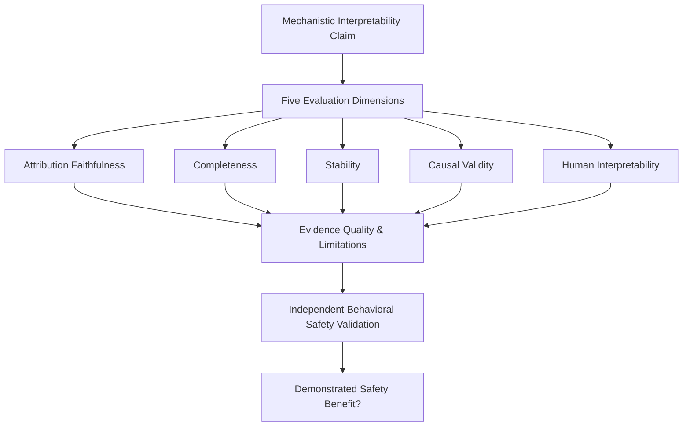

## 🔍 Does opening the black box actually make AI safer?

Our coverage of AI oversight has largely approached the question of whether we can see what models are doing from the outside — through [incident taxonomies](https://minwu-ai.github.io/what-695-ai-incidents-reveal-about-human-control/), [agent benchmarks](https://minwu-ai.github.io/why-your-agents-pass-rate-alone-isnt-enough/), and [chain-of-thought monitoring failures](https://minwu-ai.github.io/chain-of-thought-monitoring-can-fail-without-an-adversary/).

A new 27-author survey asks a more fundamental question from inside the interpretability literature itself: **Does understanding how AI models work actually make them safer, or does it simply make their behavior more explainable?**

The [November 2026 survey](https://arxiv.org/abs/2611.08438), led by Fazl Barez and Tung-Yu Wu, includes contributors such as Yoshua Bengio, Stella Biderman, and Sara Hooker. Its central challenge is straightforward: researchers often assume that understanding a model's internal mechanisms will improve safety, but that connection remains insufficiently tested.

Mechanistic interpretability attempts to identify the internal computations, representations, and circuits responsible for model behavior. Unlike approaches that observe inputs and outputs, it examines what happens inside neural networks.

But identifying a mechanism is not the same as demonstrating that the mechanism can be reliably monitored, predicted, or controlled.

That distinction runs through the survey.

## ⚙️ Five dimensions for evaluating interpretability claims

One of the paper's most useful contributions is a **Unified Evaluation Framework** spanning five complementary dimensions.

| Dimension | Core question |
|---|---|
| Attribution faithfulness | Does the explanation accurately represent the mechanism responsible for the behavior? |
| Completeness | How much of the relevant computation or behavior does the explanation capture? |
| Stability | Does the finding persist across models, training runs, or experimental conditions? |
| Causal validity | Does intervening on the identified mechanism produce the predicted behavioral effect? |
| Human interpretability | Can humans meaningfully understand and use the explanation? |

These dimensions address different weaknesses in existing methods.

For example, [sparse autoencoders (SAEs)](https://transformer-circuits.pub/2023/monosemantic-features/index.html) attempt to decompose model activations into interpretable features. But a feature that appears meaningful in one experiment may not remain stable across training seeds or architectures.

Similarly, [circuit discovery research](https://transformer-circuits.pub/2022/toy_model/index.html) illustrates how neural networks can distribute representations across multiple components, complicating attempts to identify complete causal mechanisms.

Steering vectors can modify behavior by intervening on internal representations, but an intervention that works on a narrow benchmark may produce unintended side effects elsewhere.

The survey's framework therefore emphasizes evaluating not just whether an explanation looks convincing, but whether its claims survive independent tests.

*Conceptual visualization adapted from the [survey's evaluation framework](https://arxiv.org/abs/2611.08438), with an additional practitioner-oriented safety-validation step. The framework is not a binary certification of model safety.*

Importantly, the authors do not establish universal passing thresholds. Their framework provides a structured basis for assessing evidence, not a guarantee that a model is safe.

## 🚧 Where current methods fall short

The [survey organizes interpretability research](https://arxiv.org/abs/2611.08438) into six orientations: pragmatic, ambitious, developmental, across-time, introspective, and automated.

Two areas particularly illustrate the difference between promising research and dependable safety evidence.

### 1. Models explaining themselves

Introspective methods ask models to describe their own internal reasoning, representations, or decision processes.

Such explanations may be useful, but they cannot independently establish the absence of deception, hidden objectives, or other undesirable mechanisms.

A model's self-description is itself generated by the model. It may be incomplete, inaccurate, or influenced by the same behaviors researchers are trying to investigate.

This echoes concerns raised in [Anthropic's research on chain-of-thought faithfulness](https://www.anthropic.com/research/reasoning-models-dont-say-think) and our earlier discussion of [monitoring failures without an adversary](https://minwu-ai.github.io/chain-of-thought-monitoring-can-fail-without-an-adversary/).

**A model's account of what it is doing is not necessarily a faithful record of what caused its behavior.**

### 2. Automated interpretability

Automated systems can help identify features, label internal representations, and investigate circuits at scales that manual researchers cannot match.

For example, [Anthropic's automated interpretability research](https://www.anthropic.com/research/large-language-models-can-be-interpreted) demonstrates how language models can help generate explanations of individual neurons.

But automation introduces another problem: an incorrect explanation can be generated, accepted, and propagated across thousands of features.

The survey emphasizes the continued need for human oversight and independent validation.

This does not mean automated interpretability is ineffective. It means that **scaling the production of explanations is not equivalent to scaling their reliability.**

## 📊 When simpler methods outperform sophisticated ones

One of the survey's most consequential implications concerns evaluation baselines.

Mechanistic interpretability has invested substantial research effort in sparse autoencoders and detailed circuit analysis. Yet more elaborate internal explanations do not necessarily outperform simpler methods on practical tasks.

The [AxBench benchmark](https://arxiv.org/search/?query=AxBench&searchtype=all), discussed in the survey, provides an example: relatively simple approaches can outperform SAE-based methods on certain evaluated steering tasks.

This does not establish that linear probes, prompting, or other baselines are universally superior to SAEs. Detection, explanation, and steering are different objectives, and performance depends on the benchmark and experimental setup.

Instead, it exposes a methodological weakness: **interpretability methods should be evaluated against the safety task they are intended to support, not primarily against how sophisticated their internal explanations appear.**

A method that produces detailed descriptions of model representations may be scientifically valuable without being the best tool for detecting harmful behavior.

Conversely, a simple detector may work well without providing a deep mechanistic explanation.

Both contributions matter, but they should not be conflated.

## ⚠️ Interpretability can introduce risks of its own

The [survey also examines risks](https://arxiv.org/abs/2611.08438) arising from interpretability research itself.

| Risk category | Potential consequence |
|---|---|
| Epistemic | Partial or incorrect explanations create false confidence in model safety |
| Operational | Unreliable findings lead to ineffective interventions or deployment decisions |
| Adversarial | Mechanistic insights potentially help attackers identify or exploit weaknesses |
| Opportunity cost | Resources devoted to interpretability displace other potentially effective safety approaches |

The epistemic risk is especially important.

An organization may feel more confident deploying a system because researchers have identified apparently interpretable features associated with its behavior.

But if those features are incomplete, unstable, or causally misleading, the additional visibility could create an illusion of control.

In that situation, interpretability does not merely fail to reduce risk. **It may change how decision-makers perceive risk without changing the underlying system's reliability.**

## 🧭 What this means for AI safety practitioners

The survey adds an important layer to several oversight problems previously discussed on this site.

| Prior framing | What the survey adds |
|---|---|
| [AI incident evidence](https://minwu-ai.github.io/what-695-ai-incidents-reveal-about-human-control/) shows oversight can fail in practice | Internal explanations also require independent evidence of reliability and safety benefits |
| [Chain-of-thought monitoring](https://minwu-ai.github.io/chain-of-thought-monitoring-can-fail-without-an-adversary/) has faithfulness gaps | Model introspection faces related problems of incomplete or unreliable self-reporting |
| [Agent benchmarks](https://minwu-ai.github.io/why-your-agents-pass-rate-alone-isnt-enough/) can miss important behaviors | Automated interpretability can introduce systematic errors requiring separate validation |
| Safety interventions should reduce undesirable behavior | Causal validity, generalization, and side effects must be evaluated rather than assumed |

For model validators, auditors, and AI governance teams, the practical implications are concrete.

**First, define the safety objective before selecting an interpretability method.** Is the goal to detect deception, identify unsafe representations, explain a failure, or change model behavior? These objectives require different evidence.

**Second, demand meaningful baselines.** A sophisticated mechanistic technique should demonstrate what it adds beyond simpler behavioral tests, probes, or monitoring systems.

**Third, separate explanatory quality from safety effectiveness.** A compelling explanation is not sufficient evidence that an intervention will prevent harmful behavior, generalize to new conditions, or avoid unintended consequences.

Finally, interpretability findings should be treated as one source of assurance within a broader validation framework, alongside behavioral testing, adversarial evaluation, monitoring, and operational controls.

## 🎯 The real test is whether understanding changes outcomes

The [27-author survey](https://arxiv.org/abs/2611.08438) does not conclude that mechanistic interpretability has failed. Nor does it dismiss the scientific value of understanding neural networks.

Its contribution is to challenge a widely held assumption: that making AI systems more understandable necessarily makes them safer.

Understanding can support safety. It may reveal hidden mechanisms, improve monitoring, or enable more targeted interventions.

But those benefits need to be demonstrated rather than inferred.

For practitioners, the relevant question is therefore not simply whether researchers can explain what a model is doing.

**It is whether that explanation helps us detect, predict, prevent, or correct dangerous behavior more reliably than we could without it.**

Until that connection is established, interpretability should be considered a promising source of safety evidence — not a substitute for demonstrating safety.
