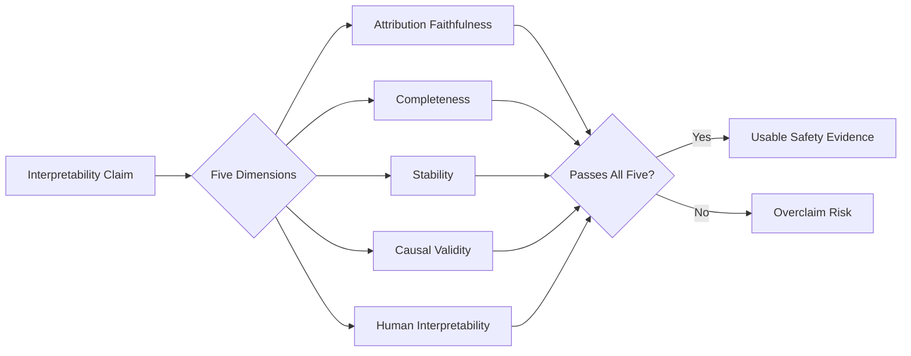

## 🔍 The question nobody had structured an answer to

Our coverage of AI oversight has mostly approached the "can we actually see what models are doing" question from the outside — through [incident taxonomies](https://minwu-ai.github.io/what-695-ai-incidents-reveal-about-human-control/), [agent benchmarks](https://minwu-ai.github.io/why-your-agents-pass-rate-alone-isnt-enough/), and [chain-of-thought monitor failures](https://minwu-ai.github.io/chain-of-thought-monitoring-can-fail-without-an-adversary/). A new 27-author survey answers a more fundamental version of the same question from inside the interpretability literature itself: does opening up the black box actually make models safer, or does it just make them legible?

The paper, [posted to arXiv on November 5 and revised November 9](https://arxiv.org/abs/2611.08438), is led by Oxford's Fazl Barez and Tung-Yu Wu, with a co-author list that includes Yoshua Bengio, Stella Biderman, and Sara Hooker — a roster that gives the paper's skepticism institutional weight rather than contrarian flavor. Its framing is blunt: "We survey mechanistic interpretability for AI safety in order to answer the question: Does understanding how models work actually make them safer?"

## ⚙️ A framework for catching overclaiming

The paper's structural contribution is a **Unified Evaluation Framework** spanning five dimensions that any interpretability method should be tested against: attribution faithfulness, completeness, stability, causal validity, and human interpretability. For each major method family — sparse autoencoders, circuit discovery, probing, steering vectors — the framework lists which checks to prioritize under each dimension, such as cross-seed alignment for SAEs, behavioral coverage for circuits, and intervention efficacy with side-effect analysis for steering.

This matters because, as the authors note, "although many prior studies in the interpretability community assume that mechanistic understanding directly implies safer systems, the assumption is in fact largely untested." The framework is explicitly a corrective instrument, not a celebration of the field's progress.

## 🚧 Where the skepticism bites hardest

The paper organizes current research into six orientations — pragmatic, ambitious, developmental, across-time, introspective, and automated — and its harshest judgments land on the last two. On models explaining their own internals, the survey is categorical about the limits: "Introspective methods are insufficient for: (1) Claims of absence: claims about the absence of deceptive reasoning or hidden objectives cannot be established by self-report alone; (2) Formal guarantees: self-reports do not provide the causal" grounding needed. Automated interpretability agents fare little better — the survey argues "Automated Interpretability still requires human oversight to catch systematic errors."

A third-party technical summary captures the sharpest empirical finding buried in the paper: on detecting hidden misbehavior, a contrast-pair linear probe on the residual stream detects triggered defection at over 99% AUROC even when trained without the trigger, and supervised probes and prompting similarly beat SAEs on concept detection and steering on AxBench — despite sparse autoencoders receiving by far the most research attention in the survey itself. Detection, in other words, is outrunning the tools the field has invested most heavily in, and simple baselines are quietly beating the more celebrated mechanistic methods.

The survey also inverts the usual pitch for interpretability as a pure safety good. It devotes a full section to the risks mechanistic tools themselves introduce — epistemic risks from false confidence created by partial or incorrect understanding — alongside operational and adversarial risks when white-box findings are acted on prematurely.

## 🧭 Where this leaves practitioners

| Prior framing on this site | What the survey adds |
|---|---|
| Incident/benchmark evidence that oversight breaks down in practice | A structural reason it breaks down: detection and control are evaluated on different, often incompatible, standards |
| CoT monitoring faithfulness gaps | Introspective self-report faces the same validity problem, one layer deeper |
| Automated alignment research limits
