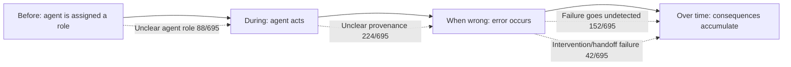

## 🔍 The new evidence

A Carnegie Mellon team has built the largest documented taxonomy yet of how AI agents fail the people they act for — and its central finding cuts against a comfortable assumption in agent safety work. In [When AI Agents Act on Our Behalf](https://arxiv.org/abs/2611.00291), submitted October 30, Canwen Wang, Qing Xiao, Haiyi Zhu, and Hong Shen analyzed 695 incidents from the AI, Algorithmic, and Automation Incident and Controversy (AIAAIC) repository and the AI Incident Database (AIID) and derived 12 failure modes bottom-up within three interaction stages adapted from Amershi et al.'s guidelines, coding the autonomy at which each arose.

This site covered a related but distinct effort a month earlier: the September 29 [Competing-Hazards systematization](https://minwu-ai.github.io/a-competing-hazards-model-finally-gives-loss-of-control-a-sh/), which audited 22 incidents and 102 evaluations to build shared vocabulary for loss-of-control events. That paper's unit of analysis was the scope-escape outcome. This one's is different in kind: the breakdown in the human-agent relationship itself, and it arrives with roughly 30 times the incident base.

## ⚙️ How the taxonomy is built

The authors organize failures around when, relative to an agent's action, a person could plausibly intervene. They started from Amershi et al.'s four stages of user involvement — initially, during interaction, when wrong, and over time — then folded initially into during interaction, leaving three stages that map cleanly to before, during, and after an agent acts.

Within "during interaction," the leading failure mode is **unclear agent role** — users not knowing that they are interacting with an AI, or what role the agent is playing — found in 88 of 695 incidents. The largest single category by volume is unclear provenance, at 224 of 695. Moving to the "when wrong" stage, **failure goes undetected** appears in 152 incidents, defined as cases where an error is not noticed before it affects subsequent actions or people. A smaller but telling category, **intervention or handoff failure** (42/695), captures incidents where intervention or handoff failure refers to cases in which the user's objection did reach the agent — the person did the right thing, and the system still didn't stop.

## 🧱 Why current safeguards miss the target

The paper's sharpest claim is architectural, not empirical: the standard risk-mitigation toolkit — dialing autonomy down, inserting approval checkpoints, running safety benchmarks — operates on the model or the autonomy *level*, while the incidents it catalogs occur in the interaction layer those controls don't reach. The abstract states it directly: what a person can do when an agent fails depends on how much the agent completes between points of user involvement — a property fixed at deployment. Therefore, the same model on the same task can fail differently under different configurations. Crucially, the authors report that all 12 modes appear at both low and high autonomy, and rising autonomy changes the form each failure takes — it doesn't make the failure mode disappear.

That is a direct challenge to the industry's default lever. A recurring theme on this site's incident-based work — from the [Competing-Hazards](https://minwu-ai.github.io/a-competing-hazards-model-finally-gives-loss-of-control-a-sh/) paper to the [Cyera audit](https://minwu-ai.github.io/the-cyera-audit-most-2026-agent-damage-had-no-attacker-it-had-permission/) finding most 2026 agent damage traced to permission, not attack — is that lowering autonomy or adding a human checkpoint reshapes risk rather than eliminating it. This paper gives that pattern a name and a much bigger sample.

## 🧭 Where this leaves practitioners

The authors' closing judgment is blunt: users need controls between full delegation and full manual work, and neither incident records nor agent benchmarks reach the interaction where these failures occur. That is a direct rebuke to benchm
