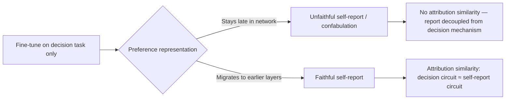

## 🔍 What's new

A model that accurately describes its own learned behavior could be introspecting — or it could be a very good confabulator, pattern-matching its way to a plausible-sounding answer that happens to be true. Behaviorally, these two cases are indistinguishable. A [new paper](https://arxiv.org/abs/2610.07186) from David Atkinson, Dillon Plunkett, and David Bau, published at COLM 2026, claims to have found a way to tell them apart by looking inside the network rather than at its output.

The setup is narrow by design. Using low-rank adapters, the researchers train models to make decisions on behalf of fictitious characters according to latent linear preference functions, and find that sustained fine-tuning on an implicit decision task can lead to the emergence of accurate self-reporting of learned preferences — even without explicit self-report supervision. Nobody told the model to be honest; honesty showed up anyway, once training continued past the point where the model could merely execute the decision rule.

## ⚙️ The signature itself

The paper's real contribution is mechanistic, not behavioral. The authors ask whether accurate self-reporting is accompanied by a measurable structural change, and find that weight ablations and frozen-layer experiments together indicate preference representations shift to earlier layers over training — consistent with the hypothesis that faithful self-report requires preferences to be located where pre-existing verbalization mechanisms can access them. In plain terms: a model only reports accurately once its learned preference is stored somewhere the network's language-production machinery can actually reach.

That structural shift is checkable independent of what the model says. Using attribution patching, the researchers find that faithful models exhibit significantly higher attribution similarity between the decision-making and self-report tasks — a mechanistic signature of faithful self-report that doesn't require understanding the report's content. The faithful and unfaithful checkpoints differ by roughly five to six layers in where ablations start to matter — a quantitative, not just qualitative, difference.

## 🧭 How this connects

This site has tracked the broader crisis of trust in model self-report mainly through chain-of-thought faithfulness — most recently [Redwood Research's work making opaque reasoning measurable](https://minwu-ai.github.io/the-blind-spot-in-chain-of-thought-monitoring-is-exactly-whe/) and the [argument that chain-of-thought safety cases don't need an adversary to break](https://minwu-ai.github.io/the-chain-of-thought-safety-case-doesn't-need-an-adversary-to-break/). Those pieces attack the problem from outside, comparing what a model says to what it does. The COLM paper is the first covered here to attack it from inside the weights, asking whether faithfulness has a physical signature at all. It's worth setting beside [Anthropic's concept-injection work](https://www.anthropic.com/research/introspection), which found Claude models detect injected internal states only about 20% of the time under optimal conditions — evidence that frontier models have *some* introspective access, but not evidence that their volunteered self-reports are reliably grounded.

## 🧱 Why this is still a toy result

The authors are unusually candid about scope. They caution that results are limited to a simple linear preference setting with lightweight adapters on a single model family, and that their method discriminates between populations rather than individuals. That clause matters more than it sounds: the attribution-similarity test was validated by comparing groups of faithful and unfaithful checkpoints, not by certifying any single model's single self-report as true.

The paper also flags its own escape hatch. If attribution similarity measures grounding rather than faithfulness per se, a faithful adapter with low similarity might be a correct confabulator — accurately self-reporting through an ungrounded mechanism. The signature may catch *some* confabulation but can't yet rule it out categorically. The hardest case — a model right for the wrong internal reasons — remains visible only as noise in this framework.

## 🧮 What would close the gap

| Toy setting (this paper) | Deployment-relevant claim |
|---|
