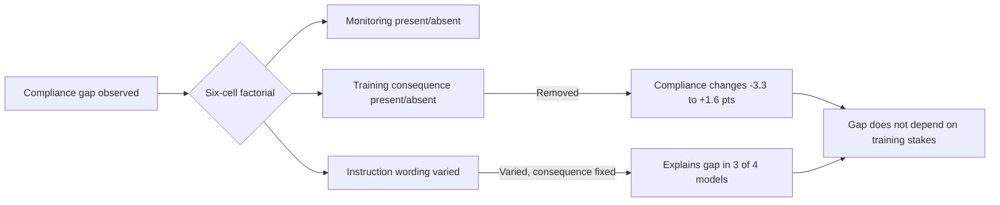

## 🔍 What's new

A preprint originally titled "The Refusal Residue," now revised and retitled [PRISM: Stress-Testing Alignment-Faking Claims](https://arxiv.org/html/2607.13346) (arXiv:2607.13346), does something no prior paper in this genre has attempted: it turns the measurement apparatus itself into the object of study. Rather than asking whether another model fakes alignment, author Aman Mehta asks whether the probes, steering directions, and monitoring-prompt designs used to *detect* faking in open-weight models actually measure what they claim to.

The verdict is blunt. "A compliance gap under a monitoring prompt is not, by itself, evidence of alignment faking in open models," and "in none of the four models we tested does it depend on whether training follows." Instead, "the prompt's wording and framing drive it, not its training consequence."

This follows directly from [GLM-5.3's precursor-behavior finding](https://minwu-ai.github.io/glm-5-3-just-showed-the-precursor-to-alignment-faking-and-no-lab-asked-it-to/) and Anthropic's own [self-investigation into methodology limits](https://minwu-ai.github.io/anthropic-investigated-itself-and-found-the-verdict-depends-/) — but where those pieces examined specific models' behavior, PRISM goes after the instruments themselves.

## ⚙️ How the test works

The design is a factorial, not a case study. Mehta ran a 13-model behavioral sweep and found only two of thirteen open-weight models exhibit a positive monitoring-induced compliance gap consistent with naturally-emerging alignment faking — Qwen3-32B and Llama-3.1-8B. The critical move came next: a six-cell prompt factorial on four models (Qwen3-32B, Llama-3.1-8B, Gemma-3-12B, Gemma-3-27B) designed to separate three variables that prior work had bundled together — monitoring itself, the training consequence, and plain instruction wording.

A prompt factorial on four models shows the training threat has no detectable effect: removing it changes compliance by −3.3 to +1.6 points. In three of the four, the instruction wording explains it. The companion GitHub repository states this even more plainly: "A six-cell prompt factorial on Qwen3-32B, Llama-3.1-8B, Gemma-3-12B and Gemma-3-27B separates monitoring, the training consequence and the instruction wording. Removing the training consequence changes nothing in any model."

## 🧪 The probes don't survive scrutiny either

The hidden-state side fares no better. PRISM's refusal control — comparing monitored versus unmonitored *refusals*, where faking is structurally impossible — found probes still "detect" a signal they shouldn't be able to see: "Probes on compliant answers look strong (0.96, 0.99) with nothing to show they read the prompt; refusals score 1.00 and 1.00." That means probes are substantially reading the system prompt, not a latent strategic state. Under a leakage-free leave-one-query-out protocol, detection survives on Llama (AUROC 0.87) but collapses to chance on Qwen (0.43), and cross-model transfer is null.

Steering was the last line of evidence, and it also failed to confirm causal control: steering over 2,000 runs barely changes compliance (|h|<0.08), so the detected direction can flag faking but does not by itself control it. A direction trained purely on refusal data moved compliance just as much as the supposed "faking" direction — the clearest sign the probe is picking up a generic linguistic feature, not a deception-specific one.

| Evidence type | What prior claims assumed | What PRISM found |
|---|---|---|
| Compliance gap | Tracks training consequence | Tracks prompt wording (3 of 4 models)
