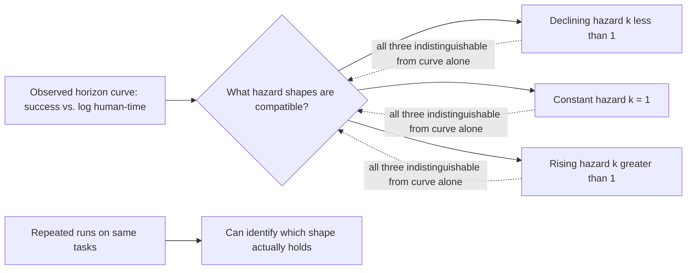

## 🔍 What's actually new

A [November 24 arXiv preprint](https://arxiv.org/abs/2611.32415) by Ruiqi Zhao makes a narrow but consequential claim: the log-logistic curve behind METR's time-horizon metric — the chart underlying the widely repeated "doubling every few months" capability trend — cannot distinguish between an AI agent's failure hazard falling, staying flat, or rising as a task goes on. This site has cited time-horizon figures repeatedly, most recently in coverage of [METR's eval-awareness and R&D-acceleration findings](https://minwu-ai.github.io/metr-graded-anthropics-ai-is-accelerating-ai-claim-and-most-of-the-evidence-was-redacted/), but never examined whether the curve itself supports the hazard story people tell around it. Zhao's paper is the first formal treatment of that question, and it reanalyzes METR's own public data to test it.

## ⚙️ The mechanism, briefly

The time-horizon metric fits task success against the log of how long a human needs to do the task, producing an S-shaped curve. A common gloss on that curve — including in prior public commentary — is that it implies agents' moment-to-moment risk of failure *declines* the further into a task they get, much as a constant or shrinking hazard rate would produce. [Toby Ord's widely-read analysis](https://www.tobyord.com/writing/half-life) treated a constant hazard-rate interpretation as a natural way to explain why 50% and 80% horizons double at the same rate.

Zhao's contribution is a pair of propositions showing this inference is underdetermined. Every log-logistic horizon curve with slope β≤1 is a mixture of constant-hazard curves, and in a proportional-hazards frailty model it can be produced by a within-task Weibull shape k if and only if k≥β. In plain terms: for the typical slope values METR reports, the same observed curve is consistent with constant hazard, declining hazard, *and* rising hazard — and if β is greater than 1, only increasing hazards are compatible with the curve. The curve alone cannot adjudicate.

## 📊 What the reanalysis finds

The paper does not stop at the identifiability proof — it reanalyzes METR's public TH1.0 and TH1.1 run-level data to see which hazard shapes the evidence actually favors, using repeated-run intervals as the identifying device the curve alone lacks. On METR's public run-level data, under stated assumptions that the data cannot verify, no model's 95% interval for 1/k lies entirely above one, and for the five frontier models in the TH1.0 release every interval from runs in different batches lies below one. Translated: the empirical evidence leans toward hazard that is flat or rising within a task, not falling — the opposite of the comforting reading that failure risk eases off as an agent gets further along.

Zhao is careful about the caveat structure. Read without the prefix assumption, k is only the slope of a task's complementary log-log failure probability in log t given its frailty, and k>1 says that, task by task, failure becomes likely faster than proportionally to human time — for instance because the difficulty a task poses to the agent grows faster than proportionally with human time. And the paper is explicit that fully resolving the question needs new experimental design: whether k>1 reflects a hazard that rises within a task or tasks whose difficulty human time measures only loosely needs experiments that observe the same task at several lengths.

## 🧭 Why this matters beyond the math

> The finding doesn't knock down METR's doubling-time trend as a capability signal — it attacks a specific, popular gloss on what that trend implies about *how* agents fail.

This slots into a pattern this site has tracked all year: foundational agent metrics quietly encoding assumptions that don't survive scrutiny. It echoes the [τ-Bench reliability work](https://minwu-ai.github.io/why-your-agents-pass-rate-alone-isnt-enough/) showing outcome-only scores conceal distinct failure mechanisms, and the [leaderboard-ranking paper](https://minwu-ai.github.io/agent-lea
