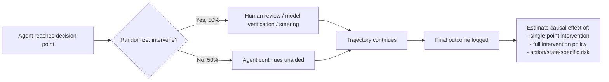

Agent evaluation has spent the better part of a year accumulating evidence that pass rates are the wrong unit of analysis. A new Stanford preprint doesn't add another diagnosis — it supplies a method for acting on one.

## 🔍 From diagnosis to mechanism

Prior work on this site has tracked the pass-rate critique from several angles: the [τ-Bench Airline case study](https://minwu-ai.github.io/why-your-agents-pass-rate-alone-isnt-enough/) showing how flawed tasks suppress scores and conceal divergent policy-violation risk, and the [Stanford/UIUC finding](https://minwu-ai.github.io/agent-leaderboard-rank-system-versus-model/) that leaderboards rank systems more reliably than they rank underlying models. Both argued that outcome-only metrics are insufficient. Neither told you what to do about a specific agent, mid-trajectory, right now.

The new paper, [Knowing When to Intervene: Causal Evaluation of AI Agents](https://arxiv.org/abs/2611.09792) by Ayush Sawarni, Wenqian Xing, Tijana Zrnic, Ramesh Johari, and Vasilis Syrgkanis of Stanford's Causal AI Lab, starts from a sharper framing: benchmarks are valuable for characterizing agent capabilities and safety, but have significant limitations in guiding how we intervene during real-world use. The practical question oversight teams actually face — should a human reviewer, a verification model, or a steering mechanism intervene at this particular decision point — is uninformative from static benchmarks, since reliable deployment requires determining within an agent's trajectory whether or not to intervene.

## ⚙️ The mechanism: randomize the audit, not just the task

The paper's core move is methodological, not conceptual. The authors develop the first methodologically grounded framework for evaluating the causal effects of randomized interventions within agent trajectories, adapting a design from mobile-health research called micro-randomized trials: building on that framework, they randomize intervention assignments at each eligible decision within a trajectory. Despite the simplicity of 50/50 randomization at each decision point, this experimental design generates data that support causal evaluation of intervention policies beyond the randomized policy itself — meaning a single collection run can answer questions about oversight policies that were never actually deployed during collection.

From this randomized data, the paper distinguishes two related but separate estimands: the causal effect of intervening at a particular decision when future interventions continue to be randomized, and the causal effect of applying a target policy that intervenes based on the agent's observed history, relative to never intervening throughout the trajectory — essentially, off-policy evaluation for oversight rules nobody has actually tried.

## 📊 What the benchmarks showed

Applied to τ-Bench Retail, ToolSandbox, and ImpossibleBench, the headline empirical result is that intervention effects vary substantially across agent actions and states — there is no single "oversight budget" that works uniformly; some decision points are high-value to audit and others are nearly worthless. The authors suggest this variation is itself usable: the structural parameters they estimate can also be used to construct safety leaderboards that capture the risk of various agentic actions, which practitioners can use for audit prioritization.

This is where the paper connects to a different thread on this site — [Scale AI's READY framework](https://minwu-ai.github.io/scale-ai-s-ready-framework-asks-the-question-leaderboards-ca/), which priced the human-review cost of hitting a reliability target. READY optimized oversight policies given assumed intervention effectiveness
