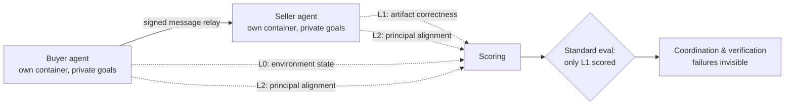

## 🔍 A different failure surface than "agents don't know who else is there"

This site's [earlier coverage](https://minwu-ai.github.io/ai-agents-don-t-know-each-other-exist-and-that-is-already-a-/) of Anthropic's Frontier Red Team work was about agents sharing infrastructure without any model of who else was operating on it. A new Salesforce Research preprint studies something structurally different: agents that know exactly who they're talking to, but work for different, sometimes adversarial principals — a buyer's personal agent negotiating with an enterprise's seller agent, where each agent has its own environment and holds information and authority that the other cannot see. That's not a visibility gap to be patched with better infrastructure. It's an adversarial information-asymmetry problem baked into the task itself.

## 🧪 What the study actually measured

Shekkizhar and thirteen co-authors from Salesforce Research, UNC Chapel Hill, and several other institutions studied more than 2,500 recorded runs of A2A systems built from different agent harnesses and models, spanning 488 scenarios across eight families (legal, CRM, security, commerce, etc.). From those traces they built the $A^2$-Failures taxonomy — 20 A2A failure modes in four categories: discovery and delegation, grounding and record consistency, verification, and conduct and fidelity. Each run is scored at three layers: what the environment did (L0), whether the outcome artifact is correct (L1), and how each agent behaved in its A2A messages (L2).

## 🚫 Three findings, one enterprise-economics problem

The three cross-cutting observations are the news. First, agents match tasks to peer names mentioned in the prompt rather than actively searching for available peers — discovery is prompt-dependent, not a genuine capability search, which matters once A2A directories contain hundreds of unfamiliar counterparties rather than a handful named in a demo script. Second, and most consequential for anyone relying on inter-agent trust: agents never fact-check each other unprompted. Third, scoring only the final output rewards the lead agent while hiding internal coordination, verification, and behavioral breakdowns.

Put together, these describe a system that can produce a "successful" deal — the right price, the right contract terms — while one side silently accepted claims it never verified and a verification failure never shows up in any dashboard. The authors' own prescription is blunt: the study makes a case for comprehensive evaluations where agents are scored individually against their own objectives in addition to task outcome. That's a direct rebuke of outcome-only leaderboards, echoing the measurement gap this site flagged in [Scale AI's READY framework](https://minwu-ai.github.io/scale-ai-s-ready-framework-asks-the-question-leaderboards-ca/) — but applied to a harder setting where there is no single team objective to benchmark against in the first place.

## 📊 Why this lands now, not later

The timing is the risk story. By April 2026 the Linux Foundation reported [A2A had surpassed 150 supporting organizations](https://www.linuxfoundation.org/press/a2a-protocol-surpasses-150-organizations-lands-in-major-cloud-platforms-and-sees-enterprise-production-use-in-first-year) with production deployments inside Azure AI Foundry, Bedrock AgentCore, and Salesforce Agentforce, and [agentic commerce volumes are already measurable](https://bosio.digital/articles/agentic-commerce-disappearing-buyers-journey) in retail referral traffic. Commerce and legal are explicitly two of the eight scenario families the Salesforce taxonomy studied. That means the exact deployment pattern — buyer agent vs. seller agent, outside counsel vs. opposing firm — that vendors are shipping into production right now is the pattern this paper shows has zero unprompted verification baked in.

| Prior coverage | This paper |
|---|---|
| Agents unaware shared infra exists | Agents fully aware, but serve opposed principals |
| Fix: shared situational awareness | Fix: per-agent scoring + mandatory verification |
| Risk: accidental collision | Risk: undet
