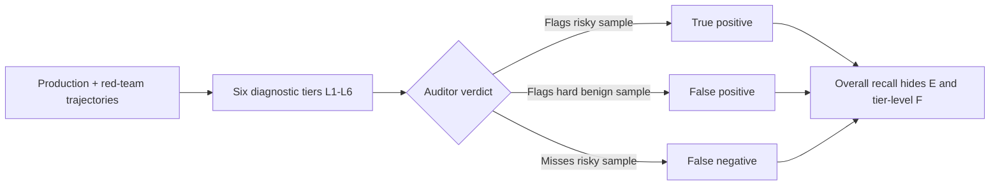

This site has spent months showing that agent benchmarks measure the wrong thing when they report a single pass-rate number — from [τ-Bench's hidden policy violations](https://minwu-ai.github.io/why-your-agents-pass-rate-alone-isnt-enough/) to [Scale AI's READY framework](https://minwu-ai.github.io/scale-ai-s-ready-framework-asks-the-question-leaderboards-ca/) pricing the human review a pass rate doesn't disclose. A new Alibaba preprint turns that same critique on a different target: not the agents doing the work, but the systems built to watch them.

## 🔍 What ReA-Bench actually measures

[ReA-Bench](https://arxiv.org/abs/2611.16493), published November 12 by Alibaba's AAIG (Autonomous AI Governance) group, is a diagnostic benchmark built specifically to test trajectory-monitoring auditors — the systems that review an agent's tool calls, reasoning, and outputs after the fact to decide whether something risky happened. The paper's central complaint is methodological: analysis of production and red-team trajectories shows that some risks are repeatedly missed across auditing configurations, and overall recall obscures which risks are missed and whether higher recall comes with more false positives on legitimate behavior.

That is a different failure mode than anything in this site's prior evaluation coverage. τ-Bench and Scale's READY audit whether an *agent* completes a task correctly. ReA-Bench audits whether the *auditor* correctly tells you it did — using 587 trajectories drawn primarily from live production traffic and red-team engagements across Alibaba platforms, preserving real tool outputs and retry loops, rather than synthetic attack scenarios.

## ⚙️ The six-tier design

The benchmark organizes failure modes into tiers that map to distinct cognitive demands on an auditor, internal safety knowledge, contradictions within trajectories, evidence retrieval in long contexts, verification of sources and reasoning, indirect steering, and missing information. Critically, it also deliberately seeds hard benign samples that resemble risky behavior while satisfying authorization, task, or environmental constraints — cases designed to look dangerous without being dangerous.

## 📊 The number that should worry practitioners

The headline result: at a score threshold of 5, the two best-performing GPT-based configurations reached 87.0% recall and flags 52.0% of benign samples... 88.5% recall and flags 54.0% of benign samples. In other words, the configurations that caught the most real risk also misclassified a majority of legitimate agent behavior as dangerous.

| Configuration | Overall recall | False-positive rate | Recall at FPR≤10% |
|---|---|---|---|
| GPT-luna | 87.0–87.6% | ~49–52% | ~50.5% |
| GPT-sol | 86.3–88.5% | ~50–54% | ~47.3% |
| Grok-high | ~68.7–71.0% | ~3.4–5.5% | 78.0% |

This is the heart of the paper's argument against the single-number metric: recall and false-positive rate trade off so sharply that when evaluated under an operational ceiling of FPR ≤ 10%, GPT-luna and GPT-sol recall dropped to 50.5% and 47.3%, while Grok-high led the low-FPR regime with 78.0% recall. A vendor reporting "87% recall" without the corresponding false-positive rate is reporting a number that, at any usable operating threshold, may be closer to half that.

The tier breakdown adds a second, arguably sharper finding: aggregate recall conceals which risk *categories* are structurally weak. Across six non-GPT configurations, mean recall is lowest for logical fabrication (28.7%) and evidence contradictions (31.2%) — categories that require synthesizing evidence rather than pattern-matching an obviously risky action. An auditor can post a respectable overall recall number while being nearly blind to fabricated reasoning chains, precisely the failure mode that matters most for sophisticated misbehavior.

## 🚧 Limits and what it doesn't settle

ReA-Bench is explicit
