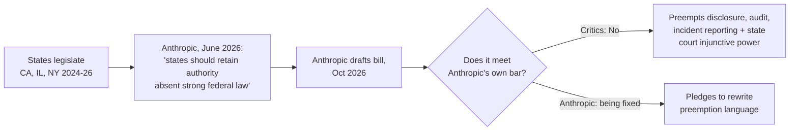

## 🔍 What just happened

Anthropic — the frontier lab that has spent two years positioning itself as Washington's safety-conscious interlocutor — has been [quietly circulating a confidential draft federal AI bill](https://www.yahoo.com/news/politics/articles/anthropic-quietly-pitches-own-ai-214514987.html) to lawmakers that would preempt state laws governing public risk disclosure, third-party evaluation, and critical-incident reporting. The draft leaked to Politico in mid-October, and the backlash was immediate enough that Anthropic's federal affairs lead publicly committed to rewriting the preemption language within days of the leak, calling it ["not precise enough."](https://thenextweb.com/news/anthropic-leaked-ai-safety-bill-backlash-frontier)

The reversal is the story. In June, as states filled Washington's legislative vacuum, Anthropic wrote that absent a strong federal law, states should retain full authority to legislate. Four months later, having drafted what it considers that strong federal law, the company is proposing federal ceilings on exactly the domains where California, Illinois and New York have been writing rules.

## ⚖️ The mechanism, and why it's narrower than it sounds

The bill's substantive core is a threshold: Commerce could seek a court order blocking a model's release only if it poses a foreseeable, imminent risk to more than 50 people or more than $1 billion in damage, and only a federal judge — not Commerce unilaterally — can issue that order, with the text explicitly bars any other federal department, agency or officer from suspending a model's development, deployment, or internal use. Independent evaluators would register with Commerce, paid by the labs they assess, and report "imminent enumerated risk" findings within 72 hours.

Critics, including Encode AI's Nathan Calvin, zeroed in on what the preemption clause actually reaches. It would preempt state laws governing frontier AI, including California's SB 53, New York's RAISE Act, and Illinois' SB 315, and also prevents state legislatures and courts from suspending a model on catastrophic-risk grounds — a reach Anthropic itself now concedes went too far, acknowledging it would also remove general powers that state courts have to enjoin defendants, and has a provision that looks intended to stop states from enforcing laws or judicial decrees that "suspend the development, deployment, or internal use" of an AI model. Politico further noted that none of the AI-agent incidents labs disclosed this summer appear to have come close to the bill's thresholds — meaning the very incidents that have driven state legislative activity this year would not have triggered federal intervention under the regime Anthropic is proposing to make exclusive.

## 🧭 Where this sits against the rest of the field

This is not an isolated maneuver. The bipartisan [FRONTIER Act](https://policygradients.thefai.org/p/the-frontier-act-is-congresss-best) already proposes narrower preemption — confined to catastrophic-risk transparency, third-party auditing, and incident reporting — and even that drew a letter from [more than 200 state legislators](https://www.thefai.org/posts/the-frontier-act-is-congress-s-best-ai-bill-yet) across 42 states. Separately, [26 state attorneys general led by Letitia James](https://www.regulatoryoversight.com/2026/10/26-state-ags-urge-congress-to-regulate-frontier-ai-and-preserve-state-authority/) wrote to Congress in September demanding comprehensive federal frontier-AI rules that explicitly exclude preemption of state authority — a position
