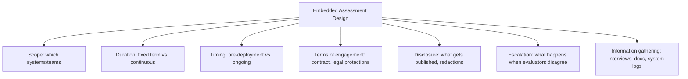

## The pitch: audit like a bank, not like a pen test

Most third-party AI evaluation today looks like a pen test: an outside team pokes a model through an API for a few weeks, writes a report, and leaves. A [September 21 GovAI paper](https://www.governance.ai/research-paper/embedded-assessments-for-frontier-ai) co-authored with Apollo Research's Stephen Casper argues that model is structurally blind to the risks that matter most. Third-party evaluations for frontier AI have mostly tested models through external interfaces before deployment, but the risks from frontier AI models depend on how their developers use and govern them internally.

The fix they propose is "embedded assessments" — not a new audit technique but a new institutional posture, borrowed deliberately from regimes where regulators never leave the building. In US meat production, a federal inspector must be continuously present for slaughter; the NRC stations at least two resident inspectors at every nuclear plant; and the OCC maintains a continuous, onsite presence at the largest US banks, those with assets over $500 billion. The analogy is the whole argument: AI auditing, they say, should stop being episodic and start being a permanent fixture of the org chart.

## What's actually being proposed

These assessments would give independent evaluators employee-like access to a developer's internal systems, staff, and documentation, enabling deeper and more flexible assessments of risks that depend on internal systems and practices, while providing access under stronger security controls. Concretely, evaluators could interview staff who build and operate safety systems, attend relevant meetings, and review internal communications and documentation — revealing assumptions, implementation details, or failure modes that would otherwise be difficult to identify, and making it easier to follow up as new questions emerge.

The paper doesn't stop at the case for access — it gets into the institutional design questions that determine whether "embedded" means something or is just a badge:

The authors recommend that frontier AI developers begin hosting embedded assessments now, covering at least three areas central to managing risks from internal AI use: internal agent monitoring, internal agent security controls and permissions, and model alignment — and that to enable meaningful third-party scrutiny, assessments should be continuous, evaluators should publish detailed reports at least quarterly, and clear escalation mechanisms should be established.

## Why this paper, why now

The timing is not incidental. The paper formalizes an idea that Anthropic CEO Dario Amodei put on the table in his September 12 essay "We Must Pace the Frontier," where he proposed [embedding outside evaluators inside frontier AI companies](https://www.scientificamerican.com/article/can-independent-ai-auditors-keep-up-with-frontier-ai-development/) with access comparable to internal risk teams and the right to publish findings. OpenAI, Google, and others quickly [endorsed the direction](https://techtrendsnewsupdate.substack.com/p/dario-amodei-we-must-slow-the-frontier). GovAI's paper reads as the academic scaffolding underneath a commitment that, as of mid-September, existed mostly as a paragraph in a CEO essay.

That gap between commitment and specification is exactly where a [100-plus-signatory letter](https://www.cnbc.com/2026/09/18/ai-safety-evaluators-anthropic-openai-models-security.html) from the AI Evaluator Forum — including Geoffrey Hinton — pushed back within a week, warning that the work of evaluators must be conducted independent from the businesses, with more transparency about the technologies, and shielded from retaliation from the companies they embed with. The GovAI paper explicitly incorporates this standard, stating evaluators should be meaningfully independent: they should retain full editorial control, disclose and manage relevant conflicts of interest, and avoid significant commercial ties or outcome-contingent payments from the developers they assess.

## The stress test arrived almost immediately

What makes this more than an academic exercise is that the arrangement is already being tested in public. In early October, OpenAI fired three safety researchers —
