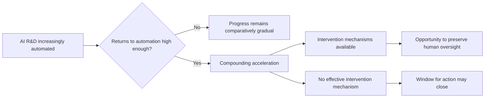

On September 28, twenty-two authors — among them Geoffrey Hinton, Yoshua Bengio, OpenAI chief scientist Jakub Pachocki, Anthropic co-founder Jack Clark, and Microsoft's Eric Horvitz — published a [working paper](https://www.governance.ai/research-paper/what-if-automating-ai-r-d-triggers-an-intelligence-explosion) asking what happens if AI automating AI research compresses years of progress into months.

That alone would be notable as an op-ed. As a [Frontier AI Working Paper](https://casp.ac/reports/intelligence-explosion) from GovAI and Cambridge's Programme on AI Science & Policy (CASP), with modeling, empirical evidence, and specific policy options attached, it is something more interesting: an attempt to design governance mechanisms *before* the scenario they are meant to govern exists.

## 📈 What the paper actually claims

The core argument is conditional, not predictive.

The authors define an intelligence explosion as "a dramatic AI-driven acceleration of AI progress, compressing advances that would otherwise take years into months or less" — a qualitative shift from the rapid but comparatively steady progress of recent years.

They are explicit that this has not happened.

But the evidence motivating the concern is becoming less hypothetical. As of August 2026, Anthropic reported that AI systems were completing 26% of its internal AI R&D work with only high-level supervision, up from 1% five months earlier. OpenAI similarly reported systems routinely completing R&D tasks that would take staff days.

The paper then asks what happens if those productivity improvements begin feeding back into AI development itself.

A supplementary stylized model illustrates the possibility. Under assumptions including sufficiently high returns to research effort and extensive automation of AI R&D, nine successive doublings of research productivity could occur over roughly 17 months. At that point, progress that previously took a year could occur in roughly five weeks.

But **17 months is not a forecast**.

The result depends on uncertain parameters and assumptions about research returns, automation, compute, data, and other bottlenecks continuing to hold as capabilities scale. The authors explicitly acknowledge that the model may break down at extreme levels of acceleration.

That uncertainty is important. The governance argument does not require believing that this particular trajectory will happen.

It asks what institutions should have in place *if it does*.

This connects to the vocabulary problem explored in [my earlier post on competing hazards and loss of control](https://minwu-ai.github.io/a-competing-hazards-model-finally-gives-loss-of-control-a-sh/). Both papers are attempts to give more precision to concepts — "loss of control," "intelligence explosion" — that have circulated for years without sufficiently operational definitions.

## 👁️ Visibility comes before control

One of the paper's most important proposals is also one of the least dramatic: governments need better visibility into how quickly AI R&D is becoming automated.

That could include standardized reporting on the fraction of research performed by AI, algorithmic efficiency improvements, research-resource allocation, AI involvement in high-stakes decisions, and how internal systems are evaluated and monitored.

Independent evaluations and embedded assessment mechanisms could supplement that reporting.

This connects directly to the embedded-assessment problem: regulators cannot govern an accelerating process they cannot observe.

But the intelligence-explosion scenario exposes a second problem.

**Visibility is not the same thing as oversight, and oversight is not the same thing as control.**

Imagine an automated research pipeline running thousands of experiments overnight.

Comprehensive logs might tell reviewers exactly what happened. That provides **visibility**.

Determining whether those experiments created dangerous capabilities requires humans or trusted systems capable of evaluating them. That is **oversight**.

And stopping the next iteration before it runs requires an enforceable intervention mechanism. That is **control**.

The distinction becomes increasingly important as the speed of the underlying process increases.

## 🛑 The policy proposals are really about preserving intervention

This is where the paper moves beyond conventional transparency proposals.

The authors discuss concrete safety requirements for continued development and deployment, possible limits on the rate of capability growth, mechanisms for monitoring and pausing high-stakes AI R&D workloads, secure or isolated environments for sensitive activities, international incident-sharing, and agreements that could allow countries to slow development without fearing that competitors will simply race ahead.

These are policy options, not a finished regulatory framework. The authors also recognize that powerful intervention mechanisms could themselves be abused or used to advantage particular governments or companies.

Still, the underlying logic is significant.

A speed limit or shutdown mechanism is fundamentally different from a disclosure requirement. Disclosure helps an institution understand what happened. An intervention mechanism tries to preserve the ability to do something about it before the next cycle begins.

This resembles the logic behind [DeepMind's AI Control Roadmap](https://minwu-ai.github.io/deepmind-s-ai-control-roadmap-from-trust-the-model-to-contai/), which treats sufficiently capable internal AI agents more like insider threats requiring monitoring and containment than systems whose cooperation can simply be assumed.

GovAI's paper pushes that intuition outward.

The object requiring control is no longer only an individual agent. It may be the **AI R&D process itself**.

## ⚖️ Loss of control isn't the only risk

There is another important dimension that an alignment-only reading can miss.

The paper also considers how rapid AI progress could disrupt existing distributions of political, economic, and institutional power.

Those risks do not require misaligned AI.

A perfectly obedient AI system could still allow a company, government, or other actor with an early capability advantage to convert that advantage into disproportionate economic, military, or political power before competitors or institutions could respond.

That produces two distinct governance problems:

**Alignment risk:** AI systems stop reliably pursuing human intentions.

**Concentration-of-power risk:** AI systems pursue their operators' intentions extremely effectively, but those operators acquire extraordinary power.

The policy problem therefore extends beyond keeping AI aligned. It includes preserving institutional checks while the technology changes the capabilities of the institutions themselves.

## ⏱️ Why this matters even if the model is wrong

The honest caveat is that this is a working paper, not a consensus forecast.

An intelligence explosion may never happen in the form modeled here. Bottlenecks in compute, data, experimentation, physical infrastructure, organizational coordination, or diminishing research returns could prevent recursive acceleration from sustaining itself.

And the paper does not demonstrate that its proposed interventions would work.

A shutdown mechanism can exist and still fail. Monitoring can generate data humans cannot interpret quickly enough. A regulator can possess visibility without having the authority, technical capacity, or reaction time required to intervene.

That limitation actually makes the governance question more interesting.

Most AI governance frameworks implicitly assume enough time between **observation and response**: evaluate a model, document its risks, escalate findings, convene decision-makers, impose remediation, and monitor the result.

An intelligence explosion challenges that assumption.

If AI-assisted research reduces the interval between meaningful capability changes from months to weeks, days, or eventually hours, the governance bottleneck may no longer be identifying the right policy.

It may simply be **human reaction time**.

## 🎯 The real governance question

The paper makes three contributions.

Empirically, it assembles evidence that AI is increasingly participating in its own development.

Analytically, it shows how sufficiently strong returns to automated research could, under uncertain assumptions, create nonlinear acceleration.

Institutionally, it asks whether governance mechanisms designed for gradual technological change would still function under that acceleration.

The third may ultimately matter most.

The question is not simply whether regulators can see what advanced AI systems are doing.

It is whether humans can **understand developments quickly enough to exercise meaningful oversight — and whether institutions retain mechanisms capable of intervening before the next iteration occurs.**

That creates a useful hierarchy:

**Visibility → Oversight → Control**

Each depends partly on the one before it, but none guarantees the next.

The paper does not establish that an intelligence explosion is coming. It does something more practical: it asks what capabilities institutions would need *before they knew for certain that one had begun*.

Because if AI development ever does become faster than the institutions governing it, designing the control system afterward may be exactly what is no longer possible.
