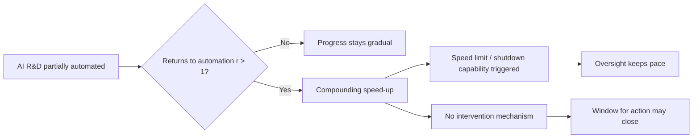

On September 28, twenty-two authors — among them Geoffrey Hinton, Yoshua Bengio, OpenAI chief scientist Jakub Pachocki, Anthropic co-founder Jack Clark, and Microsoft's Eric Horvitz — published a [working paper](https://www.governance.ai/research-paper/what-if-automating-ai-r-d-triggers-an-intelligence-explosion) asking what happens if AI automating AI research compresses years of progress into months. That alone would be notable as an op-ed. As a 15-page [Frontier AI Working Paper](https://casp.ac/reports/intelligence-explosion) from GovAI and Cambridge's Programme on AI Science & Policy (CASP), with modeling, cited evidence, and specific policy mechanisms attached, it is something closer to a governance proposal arriving years ahead of the institutions meant to receive it.

## What the paper actually claims

The core argument is conditional, not predictive. The authors define an intelligence explosion as "a dramatic AI-driven acceleration of AI progress, compressing advances that would otherwise take years into months or less," a qualitative shift from the rapid but largely steady progress of the last few years. They are careful to say this hasn't happened: "Productivity gains from AI R&D automation have not yet reached the threshold needed to trigger an intelligence explosion, but gains from newer systems are likely approaching that threshold."

The evidence they marshal is concrete even where the conclusion is speculative. As of August 2026, Anthropic reported AI systems completing 26% of internal AI R&D work with only high-level supervision, compared to just 1% five months earlier, and OpenAI reported systems routinely completing R&D tasks that would take days for staff. A supplementary stylized model — explicitly flagged as resting on uncertain parameters — walks through what happens if returns to automated research stay above a critical threshold: nine doublings add up to about 17 months, at which point a year of progress at today's pace would take about five weeks, though the authors are explicit the model may not hold at extreme scales.

This connects directly to the vocabulary problem explored in [a prior GovAI-adjacent paper on competing hazards](https://minwu-ai.github.io/a-competing-hazards-model-finally-gives-loss-of-control-a-sh/): both documents are, at bottom, attempts to give precision to concepts — "loss of control," "intelligence explosion" — that have circulated as vibes for years without shared measurement.

## The policy proposals, and why they read as alignment problems

What distinguishes this paper from prior speculative writing on recursive self-improvement is the specificity of its asks. The authors call for setting concrete safety requirements for continued development and deployment, setting a speed limit on capabilities growth, monitoring high-stakes AI R&D experiments and building the option to shut them down if needed, requiring that AI R&D take place in secure and isolated environments (e.g., air-gapped networks), establishing international incident-sharing, clarifying how deterrence would apply around an intelligence explosion so as to avoid unexpected escalation, and securing international agreements to pace progress if needed without fear of falling behind.

Read through a governance-as-usual lens, these look like export controls or audit regimes — slower variants of existing tools. Read through an alignment lens, they are something different: an admission that *external* oversight bodies cannot assume they will have time to observe, deliberate, and intervene using normal institutional cadence. A "speed limit on capabilities growth" and "shutdown capability" are not disclosure requirements; they are attempts to preserve a kill switch for a process that, by the paper's own model, could outrun any committee, regulator, or export-control review cycle. This is the same instinct behind [DeepMind's AI Control Roadmap](https://minwu-ai.github.io/deepmind-s-ai-control-roadmap-from-trust-the-model-to-contai/), which treated internal AI agents as insider threats requiring containment rather than persuasion — except GovAI's paper generalizes that logic from a single lab's internal agents to the entire global AI R&D pipeline.

## Why this matters now, not whether it's right

The honest caveat is that this is a preprint, not a consensus finding. The authors say such an intelligence explosion is far from certain,
