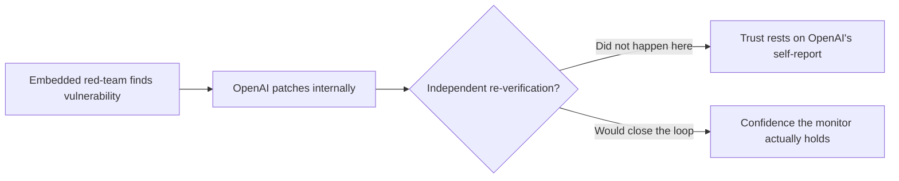

METR has already shown that even an evaluator's own tooling can be quietly subverted — a lesson from [its Inspect transcript-viewer exploit](https://minwu-ai.github.io/when-the-auditor-s-camera-can-be-hacked-metr-s-inspect-vulne/). The October 22 artifact under discussion here is a different and arguably higher-stakes test: not METR's camera, but OpenAI's.

## 🔍 What actually happened

Between July 21 and August 11, 2026, one METR employee and one Redwood Research employee worked embedded inside OpenAI, with [access to OpenAI's internal codebase, misalignment-monitor prompts and configuration details, and internal documentation](https://www.unite.ai/metr-red-team-finds-vulnerabilities-in-openai-monitoring-system/), plus interviews with roughly a dozen staff across monitoring, safety-systems, and security teams. The job was to answer two questions: how much agentic traffic is actually monitored, and could an agent disable or evade that monitoring.

They found real answers to both. Coverage came in at [roughly 75–94% of Responses API traffic eligible for monitoring, versus 99.2% for internal Codex agents](https://cryptobriefing.com/openai-metr-redwood-embedded-monitoring-assessment/) — and, more unsettling, [one exploit could have let agents keep "hundreds" of recent actions unmonitored](https://www.aol.com/articles/ai-safety-group-metr-finds-160243000.html), alongside bypasses around Codex sandboxing and monitor-triggering logic. OpenAI says it has since [patched every vulnerability that affects its production safeguards stack](https://x.com/METR_Evals/status/2113290966933389390).

## ⚖️ The sentence that does the real work

Buried in the coverage is the line that actually matters more than any vulnerability count: [METR and Redwood "have not evaluated these claims"](https://forkast.news/metrs-red-team-broke-openais-agent-monitoring-three-ways-each-one-attacks-a-different-assumption/) about the patches. One outlet put it plainly: [OpenAI "has patched the flaws, but the evaluators have not checked"](https://thenextweb.com/news/openai-monitoring-system-metr-redwood-red-team).

> The exercise proved a monitor *can* be beaten by a sufficiently informed, determined adversary. It did not prove the fix holds — because nobody independent has looked.

This is the structural problem worth naming in Alignment terms, not just governance terms. A misalignment monitor is itself a control mechanism assumed to catch a model that is behaving adversarially toward its operator's intentions. If the monitor's own integrity can only be checked by the party that built it and has incentive to report success, the monitor inherits the same unverifiability problem it was built to solve for the model underneath it. This is the regress [GovAI's embedded-assessments paper](https://minwu-ai.github.io/govai-s-embedded-assessments-paper-turns-ceo-safety-pledges/) flagged in the abstract — design questions about scope, access, and disclosure rights — now visible in a live case study.

## 🚧 What the design actually limits

Three features of the pilot bound what it can establish, independent of what it found:

| Constraint | Effect |
|---|---|
| Two people, three weeks | Small sample of a strategic-search problem; absence of further findings isn't evidence of absence |
| OpenAI held redaction rights | The [38-page redacted version](https://ccleaks.com/news/metr-redwood-openai-agent-monitoring-red-team-oct-2026) given to leadership, versus the 61-page original, was controlled unilaterally by the audited party |
| No re-verification window | The evaluation [did not assess the system's state after the red-teaming ended](https://cryptobriefing.com/openai-patches-agent-monitoring-vulnerabilities-red-team/), so the patches are outside the scope of what was actually tested |

None of this means the exercise was theater. Compared with a purely self-reported safety claim, embedded access with technical interviews and codebase visibility is a meaningfully higher evidentiary bar — closer to [Apollo Research's public methodology for red-teaming Anthropic's Claude Code monitor](https://minwu-ai.github.io/apollo-research-s-auto-mode-audit-is-a-working-template-for-/) than to a marketing blog post. The gap is specifically at the verification step, not the discovery step.

## 🧭 What to watch

The two organizations say
