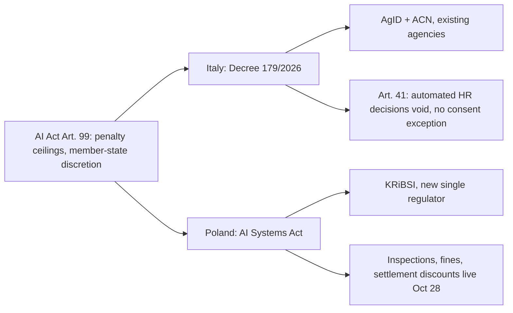

A previous post on this site examined [Brussels's first GPAI enforcement investigations into OpenAI and Anthropic](https://minwu-ai.github.io/the-eu-ai-act-s-first-enforcement-test-hinges-on-whether-a-l/), where the open question was whether conduct inside an exempt research sandbox could still trigger AI Act obligations. That was a story about a cross-border probe into lab behavior. This is a different and arguably more consequential kind of news: a national government switching on the domestic machinery that makes the AI Act enforceable against any employer at all, and setting a bar higher than Europe asked for.

## 🔍 What actually changed

Italy's Legislative Decree No. 179/2026 was [published in the Gazzetta Ufficiale on October 8, 2026 and enters into force on October 23](https://pasqualepillitteri.it/en/news/22825/italy-ai-decree-179-2026-fines-35-million-euros). It is the second of two implementing measures under Italy's national AI law (Law 132/2025), and it does the one thing the AI Act itself left to member states: it names who inspects, who fines, and how much.

The decree hands supervisory powers to AgID and ACN, sets fines of up to 35 million euros or 7% of worldwide turnover for the most serious violations, with AgID serving as notifying authority and ACN as market surveillance authority and single point of contact with Brussels. The fine structure tracks the AI Act's own ceilings but adds Italian specificity: for large companies the higher of the fixed amount and the percentage of worldwide annual turnover for the previous financial year applies, with up to €35 million or 7% for prohibited practices, and up to €15 million or 3% for provider and deployer obligations.

## ⚖️ Going further than Article 99 required

The detail that distinguishes this decree from a routine transposition exercise is Article 41. The AI Act's Article 99(4) sets penalty tiers for violating HR-related high-risk obligations, but it does not itself void an employment decision outright. Italy's decree does: an employer using an AI system to hire, evaluate, sanction or dismiss must leave the final decision to a person with effective decision-making power — otherwise the decision is void, even with the employee's consent. Industry analysis frames this plainly — Article 41 bars employers from taking final decisions on hiring, changing or ending employment, including discipline and performance appraisal, solely on the basis of automated processing, and a dismissal made in breach of that rule is void.

This is a meaningfully stronger standard than GDPR's Article 22, where explicit consent is admitted as an exception to the right not to be subject to a solely automated decision. Italy closes that consent loophole entirely for employment. A comparison table makes the layering clear:

| Instrument | Consent exception? | Remedy |
|---|---|---|
| GDPR Art. 22 | Yes | Administrative fines |
| EU AI Act Annex III (HR) | N/A — human oversight required | Up to €15M/3% turnover |
| Italy Decree 179/2026, Art. 41 | **No** | **Nullity of the decision** |

## 🏛️ Not Brussels, not Warsaw — a third enforcement pattern

Italy is not alone in flipping the enforcement switch this month. Poland's AI Systems Act brings its own inspection and fining powers into force on [October 28](https://www.dudkowiak.com/blog/polands-ai-act-enforcement-law-supervision-inspections-and-penalties), administered by a brand-new single regulator, KRiBSI, that an Oxford Blavatnik School analysis notes is one of only two EU countries to designate a single entity as its sole market surveillance authority for AI, and the only one building an entirely new institution to do it.

Where Poland built new institutional capacity from scratch, Italy repurposed existing cybersecurity and digital-agency infrastructure and used its discretion to legislate past the EU floor on worker protection. Both choices are legitimate under Article 99(1)'s instruction that national penalties be "effective, proportionate and dissuasive" — but they produce visib
