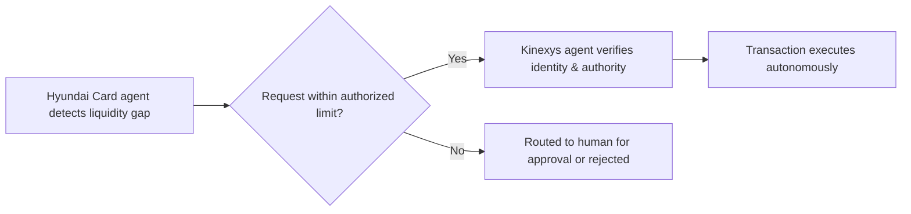

A [previously published post on this site](https://minwu-ai.github.io/a2a-commerce-is-scaling-faster-than-its-failure-modes-are-be/) argued that agent-to-agent commerce is scaling faster than the industry's ability to measure its failure modes — a diagnosis about an entire ecosystem. This week's news is narrower and more useful: one specific bank, with a named counterparty, a named executive, and a named control mechanism, on the record about what it actually costs to let two institutions' agents transact directly.

## 🔍 What actually happened

[CNBC reported](https://www.cnbc.com/2026/11/18/jpmorgan-hyundai-card-ai-agents-payments.html) that JPMorgan and South Korea's Hyundai Card completed a proof-of-concept in which a Hyundai Card AI agent requested a foreign exchange transaction to maintain euro liquidity in its Kinexys blockchain deposit account. The mechanics, per the reporting, were deliberately narrow: a treasury agent kept a euro account in Frankfurt above a minimum balance, funding any shortfall by selling pounds held in a London account, with the Hyundai Card agent monitoring balances, requesting quotes from a panel of three banks, and selecting the most competitive rate before instructing the Kinexys agent to execute the conversion and transfer. JPMorgan calls it the first private blockchain-based autonomous bank-agent-to-client-agent test for corporate treasury management. It was simulated — no live movement of funds — and the companies are targeting the first half of 2027 for a more complex phase involving multiple AI agents.

What makes this worth a separate post from the broader A2A piece is what JPMorgan's own executive chose to emphasize. Kinexys Insights head Wee Kee Toh told CNBC plainly that the technical work was relatively straightforward compared with establishing governance structures and internal controls that determine what an AI agent can do, who is responsible for its actions, and how errors can be contained. That is a bank — not a regulator, not an academic — naming governance as the binding constraint on a product it is actively building.

## ⚙️ The control JPMorgan is actually selling

The guardrail Toh described is a static ceiling: "You are going to draw a box around the agent. The agent will never be able to do anything out of the box," with an AI agent authorized to transact up to $5 million blocked from executing transactions above that threshold. Requests outside the box don't vanish — they were either referred to a human for approval or rejected.

This is a sound first control for a single bounded request. It is a much weaker answer to the scenario Toh himself flagged as the actual next phase: testing what happens when autonomous agents move beyond execution and begin interacting with each other in an ecosystem, where agents are negotiating, agreeing directly with each other and then making payments. A fixed dollar cap constrains a single hop. It says little about a chain of authorized, sub-threshold transactions across multiple counterparties that collectively produce an unauthorized outcome — the aggregation problem that per-transaction limits are structurally bad at catching.

## 📊 The price tag, in incident data

JPMorgan's framing is corroborated by independent survey evidence cited in the same report. AvePoint's State of AI 2026 findings, drawn from [750 global IT leaders](https://www.avepoint.com/blog/manage/state-of-ai-2026-report), found that unauthorized autonomous agent actions were the third most common AI agent-related security breach, affecting 34.1% of companies that reported such incidents, with those actions including executing transaction and modifying data without approval — a category not isolated to treasury but directly on point. AvePoint's CEO put the systemic risk in cascade terms: "The worst-case scenario is a cascading failure where one compromised or hallucinating agent feeds bad data to another," potentially "triggering a high-speed chain reaction of flawed financial transfers before a human even realizes it is happening."

| Control layer | What it catches | What
