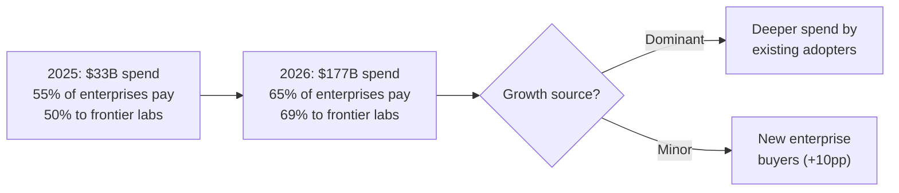

## 🔍 A different number, a bigger story

Menlo Ventures' [fourth annual State of Enterprise AI report](https://menlovc.com/perspective/2026-the-state-of-enterprise-ai/), released November 3, puts a scale on enterprise AI spending that dwarfs anything a single API-share statistic can capture: Anthropic, OpenAI, and Google capture 69% of enterprise AI spending ($122.7B) in 2026, up from 50% last year. This piece [previously covered](https://minwu-ai.github.io/anthropic-s-40-enterprise-share-is-a-governance-fact-now-not/) Anthropic's rise to roughly 40% of enterprise LLM API usage as a switching-cost and governance story. The Menlo data is a different animal entirely — a survey of nearly 400 U.S. enterprise decision-makers overseeing more than $4 billion in AI spending combined with a bottom-up analysis of the market — and it shows the concentration trend has not just continued but accelerated, while a second, less-reported number suggests the underlying adoption story is far weaker than the spend numbers imply.

## ⚙️ The mechanism: spend concentration without usage concentration

The headline growth figure is dramatic: enterprise AI spending more than quintupled, surging from $33 billion in 2025 to $176.8 billion by September 2026, accelerating from 3.9x growth the year before. But the breadth of that growth did not keep pace. Yet the share of enterprises paying for AI rose modestly, from 55% to 65%. Put differently, the market grew 5.4x while the pool of actual payers grew by only ten percentage points — meaning nearly all of the dollar growth came from existing buyers spending dramatically more, not from a broadening base of new adopters. Reuters-style framing from the report's own authors confirms the mechanism: the share of enterprises paying for AI rose only modestly, from 55% to 65%, suggesting that growth is being driven primarily by greater spending among adopters rather than a wave of new buyers.

Within that concentrated spend, the frontier labs' position tightened further still. Within enterprise LLM API spending, Anthropic extended its lead from 40% to 55%, OpenAI rose from 27% to 31%, and Google fell from 21% to 9%. Independent analysis of the report notes enterprise AI spending is increasingly concentrated among power users and a handful of model providers... Its report puts total spending at $176.8 billion by September, up from $33 billion in 2025, while enterprise adoption rose only 10 percentage points.

## 🧮 Why this isn't just a bigger version of the same story

A single API-usage share number — the kind this site covered in the [Anthropic 40% piece](https://minwu-ai.github.io/anthropic-s-40-enterprise-share-is-a-governance-fact-now-not/) — tells you about model choice within a fixed pool of users. The Menlo dataset tells you something structurally different: that the *entire pool* of paying enterprises barely moved while the dollars flowing through it exploded. That is a vendor-economics finding, not a governance-switching-cost finding. It means concentration risk is compounding on two axes simultaneously — fewer providers capturing a growing share of dollars, from roughly the same set of buyers who are now far more financially entangled with those providers than a year ago.

The report's own authors frame this as encouraging headroom rather than alarm: with so much AI spend coming from power users, both adoption and usage still have significant room to grow across the long tail of the rest of the economy. That reading is plausible — but it is also exactly the framing an investor in the leading beneficiary would offer. Menlo is, after all, an investor in Anthropic, one of the report's biggest estimated beneficiaries, and independent coverage flags that the report draws on a survey of roughly 400 US enterprise decision-makers... Its spending figures are Menlo market estim
