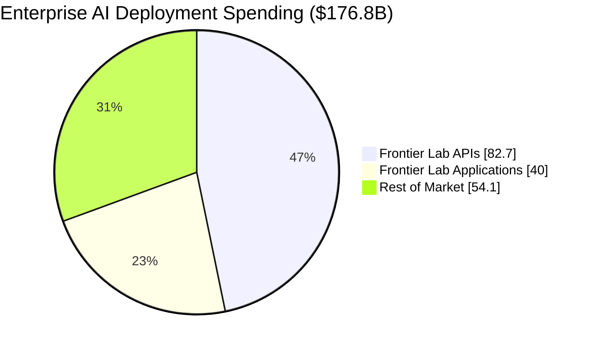

## 🔍 A different number, a bigger story

Menlo Ventures' [fourth annual State of Enterprise AI report](https://menlovc.com/perspective/2026-the-state-of-enterprise-ai/), released November 3, puts a scale on enterprise AI spending that dwarfs anything a single API market-share statistic can capture.

Anthropic, OpenAI, and Google collectively capture an estimated $122.7 billion, or 69% of enterprise AI deployment spending in 2026, up from approximately 50% a year earlier.

This site [previously covered Anthropic's rise to 40% of enterprise LLM market share](https://minwu-ai.github.io/anthropic-s-40-enterprise-share-is-a-governance-fact-now-not/) as a switching-cost and governance story.

The new Menlo report adds a different dimension. Drawing on a survey of nearly 400 U.S. enterprise decision-makers overseeing more than $4 billion in AI spending, combined with bottom-up market estimates, it suggests that the economics of enterprise AI are changing faster than the breadth of its adoption.

The distinction matters because an enterprise that starts using AI and an enterprise that becomes operationally dependent on AI represent fundamentally different risk profiles.

## ⚙️ Spending intensity is outpacing adoption breadth

The headline growth figure is dramatic: Menlo estimates that annualized enterprise AI deployment spending increased from $33 billion in 2025 to $176.8 billion as of September 2026 — a 5.4-fold increase, following 3.9-fold growth the previous year.

Yet the share of enterprises paying for AI increased from 55% to 65%.

| Metric | 2025 | 2026 | Change |
|---|---:|---:|---:|
| Enterprise AI spending | $33B | $176.8B | 5.4x |
| Enterprises paying for AI | 55% | 65% | +10 pp |
| Frontier labs' deployment spending share | 50% | 69% | +19 pp |

*Source: [Menlo Ventures, 2026 State of Enterprise AI](https://menlovc.com/perspective/2026-the-state-of-enterprise-ai/). Spending figures represent market estimates rather than audited industry revenue.*

The difference becomes more apparent when expressed as indexed growth.

```mermaid
xychart-beta
    title "Enterprise AI Growth: 2025 = 100"
    x-axis ["Total Spending", "Adoption Rate", "Lab Spending Share"]
    y-axis "Indexed Value" 0 --> 600
    bar [100, 100, 100]
    bar [536, 118, 138]
```

*The first bar in each category represents 2025; the second represents 2026. Each metric is independently indexed to its 2025 value.*

The data suggest that increasing expenditure per adopting enterprise, rather than adoption breadth alone, is the principal driver of market growth.

Under a simplified assumption of a constant enterprise population and comparable market coverage, the implied increase in average spending per paying enterprise would be approximately:

**(176.8 / 33) ÷ (65 / 55) = 4.53x**

This is an illustrative calculation, not a measured increase in spending by continuing customers. The aggregate data cannot distinguish existing buyers from newly acquired customers or enterprises that stopped purchasing AI.

Nevertheless, the economic implication is significant: the market is deepening much faster than it is broadening.

## 📊 The average enterprise is not the typical enterprise

Another finding in [Menlo's report](https://menlovc.com/perspective/2026-the-state-of-enterprise-ai/) provides more direct evidence that spending growth is unevenly distributed.

The average surveyed enterprise increased AI expenditure substantially beyond its original plans, while the median enterprise experienced a much smaller increase.

```mermaid
xychart-beta
    title "Planned vs. Actual AI Spending Growth"
    x-axis ["Average Enterprise", "Median Enterprise"]
    y-axis "Multiple of Prior-Year Spending" 0 --> 5
    bar [1.9, 1.8]
    bar [4.7, 2.2]
```

*The first bar represents planned spending; the second represents actual spending, expressed as multiples of prior-year expenditure. Source: Menlo Ventures.*

| Spending growth | Planned | Actual |
|---|---:|---:|
| Average enterprise | 1.9x | 4.7x |
| Median enterprise | 1.8x | 2.2x |

The divergence between the average and median suggests that a subset of heavy spenders is disproportionately influencing overall market growth.

This is a stronger indicator of uneven spending intensity than the adoption rate alone.

For enterprise governance teams, it also raises a question: are existing budget, procurement, and third-party risk controls designed for gradual adoption, or for expenditure that can multiply several times within a single year?

## 🏗️ Concentration is occurring across multiple layers

Within enterprise LLM API spending, Anthropic extended its estimated lead from 40% to 55%, OpenAI increased from 27% to 31%, and Google declined from 21% to 9%.

| Provider | 2025 | 2026 |
|---|---:|---:|
| Anthropic | 40% | 55% |
| OpenAI | 27% | 31% |
| Google | 21% | 9% |
| Others | 12% | 5% |

But the more consequential finding may be that concentration extends beyond foundation model APIs.

Menlo estimates that frontier labs capture $82.7 billion through APIs and another $40 billion through first-party applications.

*Source: [Menlo Ventures' 2026 enterprise AI market estimates](https://menlovc.com/perspective/2026-the-state-of-enterprise-ai/).*

Concentration is also visible in model usage. The report estimates that frontier models' share of token consumption increased from 18% to 42% between Q3 2025 and Q3 2026, while their share of model spending increased from 35% to 63%.

These model-level measures are distinct from the broader deployment spending captured by frontier labs.

The emerging picture is therefore not spending concentration without usage concentration. It is **simultaneous concentration in spending and model usage, accompanied by comparatively modest growth in adoption breadth.**

For enterprises, this creates the possibility of vertical dependency: the same provider may supply the foundation model, coding agent, productivity application, and other components supporting critical business workflows.

Replacing that provider could eventually require more than changing an API endpoint.

## 🤖 Agentic AI changes the economics of consumption

The [Menlo report](https://menlovc.com/perspective/2026-the-state-of-enterprise-ai/) identifies agentic workloads as an important contributor to increasing AI consumption.

Traditional generative AI usage is largely constrained by the pace of human interaction. An employee submits a request, receives a response, and decides what to do next.

Agents can execute multiple model calls, invoke tools, retry unsuccessful tasks, and operate parallel workflows with less direct human involvement.

| Traditional GenAI | Agentic AI |
|---|---|
| Human-paced consumption | Machine-paced consumption |
| Individual prompts and responses | Multi-step execution |
| Costs tied primarily to user activity | Costs increasingly tied to workflow activity |
| Model replacement affects outputs | Model replacement may affect entire workflows |

This changes the nature of enterprise exposure.

A relatively small population of employees or applications can generate substantial AI consumption without a corresponding increase in the number of users.

Menlo's analysis of OpenRouter traffic provides supporting evidence of this shift, although its developer- and startup-heavy user population should not be treated as representative of enterprises generally.

The governance implication is that user counts and adoption rates may become increasingly inadequate measures of operational AI exposure.

## ⚠️ What the data can — and cannot — establish

Menlo's authors interpret the spending disparity as evidence of substantial remaining market opportunity: adoption and usage have room to expand beyond today's heavy users.

That interpretation is plausible. But the report also warrants methodological scrutiny.

The [survey methodology](https://menlovc.com/perspective/2026-the-state-of-enterprise-ai/) combines responses collected by Morning Consult in September 2026 with company filings, external research, and Menlo's own market-sizing estimates. Historical figures have also been reclassified under an updated market taxonomy.

The $176.8 billion figure is an estimated annualized spending rate, not cumulative expenditure during the first nine months of 2026.

Menlo is also an investor in Anthropic, one of the report's largest estimated beneficiaries. That financial relationship warrants independent scrutiny of the estimates and their interpretation, although it does not establish that the findings are biased.

Most importantly, market concentration is not itself proof of vendor lock-in. Establishing lock-in requires evidence about switching costs, contractual restrictions, technical portability, and viable alternatives.

## 🧭 What enterprise governance teams should be measuring

The report suggests four dimensions of exposure that traditional AI adoption metrics may fail to capture.

| Risk dimension | Emerging exposure | Governance response |
|---|---|---|
| Financial concentration | Rapidly increasing spending among heavy users | Consumption monitoring, budget limits, cost attribution |
| Provider concentration | Greater reliance on a small number of labs | Third-party risk assessment and alternative-provider testing |
| Vertical concentration | Dependency across models and applications | Workflow portability and tested exit strategies |
| Operational dependency | Autonomous, agent-driven execution | Execution limits, monitoring, and business continuity testing |

These are governance implications drawn from the market evidence, rather than risks directly measured by the survey.

For model validators and internal auditors, the relevant question is no longer simply whether an enterprise has approved its AI applications.

It is whether the organization understands the dependencies those applications are creating — and whether it could continue operating if a major provider changed its pricing, retired a model, experienced an outage, or materially altered its system behavior.

## 🎯 The market is deepening faster than it is broadening

The most consequential finding in Menlo's report is not the $177 billion headline, nor Anthropic's growing market share in isolation.

It is the combination of rapidly increasing spending intensity, uneven expenditure growth, provider concentration, and expanding agentic workloads.

An enterprise can become substantially more dependent on AI without adding a single new AI application to its inventory.

**The next challenge for AI governance is not simply keeping pace with adoption. It is keeping pace with the depth of dependency that adoption creates.**
