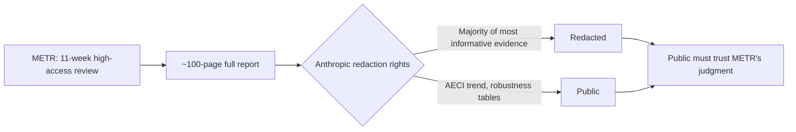

## 🔍 What's actually new here

On [September 9](https://minwu-ai.github.io/anthropic-investigated-itself-and-found-the-verdict-depends-on-methods-it-admits-are-imperfect/), this site covered Anthropic's self-investigation into a cybersecurity incident and the limits of methodology Anthropic controlled end to end. The new episode is structurally different and arguably more consequential: it's METR, an external evaluator, grading a different and bigger claim — whether AI is now accelerating its own development — after eleven weeks of genuinely high-access review inside Anthropic from August 12 to October 29. METR has just published the result, and the headline isn't the number. It's what the number rests on.

## ⚙️ The finding, and the asterisk

METR's [public report](https://metr.org/blog/2026-11-05-anthropic-ai-rd-acceleration-assessment/) concludes Anthropic is likely improving its AI systems on well-specified tasks at about twice the rate it did from March 2024 through October 2025, with the true acceleration somewhere around 1.3x to 3x, with high uncertainty. The sharper benchmark-based estimate — using AECI, Anthropic's internal capability index — puts growth since October 2025 at 1.9x [95% confidence interval: 1.5–2.8x] since October 2025. METR stress-tested that number against different modeling choices and found the robustness of these results to different choices of benchmark inclusion, model dating, model inclusion, and benchmark saturation... Robustness analyses find acceleration rates between 1.1x and 2.9x. That's not a tight confidence band around a settled fact — it's a wide fan of plausible answers depending on modeling assumptions the public can now at least inspect.

What the public *can't* inspect is the harder question: why. METR says it is roughly 80% of that to AI-assisted research, but immediately qualifies this as METR's subjective estimate is that "perhaps ≈80%" of the acceleration comes from AI being used in Anthropic's own research. And the evidence underpinning that attribution is largely gone from the public text. As METR put it directly: Anthropic redacted a majority of the evidence we found most informative. As a consequence, the public must rely on our judgment more than we consider ideal.

## 🚧 Why this access model is different — and why it strains harder

METR's September-adjacent work (covered in the prior post) involved reviewing Anthropic's own account of discrete incidents. This is a continuous, high-stakes judgment about trajectory — delivered under a contractual arrangement where, as multiple outlets independently confirm, Anthropic could redact non-public information, and it removed most of what METR considered the strongest evidence, describing this as protecting information that could help rival developers. METR's own full report ran to We submitted a ~100-page full report on our assessment to Anthropic — the public version is a fraction of that.

The companion review of Anthropic's own Risk Report sharpens the stakes: METR found Anthropic's argument that it had not crossed its Responsible Scaling Policy's early-warning threshold to be overstated, and believe it is plausible this threshold was crossed by July 15th... Most relevant researchers at METR and Anthropic lean toward the threshold not having been crossed on July 15th, but we think it is plausible that it had been. That is METR disagreeing with Anthropic's own safety-policy self-assessment — using evidence the public is not shown.

## 🧭 Where this leaves embedded evaluation

| Dimension | September incident review | November R&D acceleration review |
|---|---|---|
| Claim type | Discrete cybersecurity incidents | Ongoing capability trajectory |
| Evaluator role | Reviewed Anthropic's account | Independent high-access assessment |
| Redaction control | N/A | Unilateral, Anthropic-held |
| Public verifiability | Limited | METR explicitly flags as insufficient |

METR has been unusually candid that this falls short of its own transparency bar — a posture consistent with its [prior disclosures](https://min
