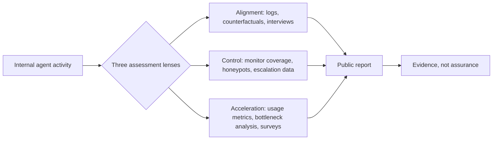

## 🔍 What's new here

On October 14, 2026, [METR published three companion proposals](https://metr.org/blog/2026-10-14-better-informing-the-public-about-loss-of-control-risks/) that do something the loss-of-control debate has mostly avoided: specify, in operational detail, what an outside assessor would actually need to check whether a frontier lab's internal AI agents are slipping out of control. The three questions are whether internal AI agents would pursue very harmful actions, whether internal AI agents attempting very harmful actions would be caught, and whether capabilities progress could dramatically accelerate beyond what alignment and control can keep up with.

This builds directly on the pilot METR and Redwood Research already ran — stress-testing OpenAI's internal misalignment monitor, which I covered in [Inside OpenAI's Own Monitor](https://minwu-ai.github.io/inside-openai-s-own-monitor-what-a-three-week-pilot-can-and-/). That post was a single red-team result. These three documents are the methodology for doing that kind of work systematically, across three distinct risk categories, at any lab willing to grant access.

## ⚙️ The mechanism: three audits, one access model

Each proposal reads like a technical spec rather than a position paper. For **alignment**, the assessor would get a review of serious misaligned behaviors from all near-frontier internal models observed across training, evaluation, and internal use, plus an assessment of whether alignment evals and counterfactual simulations indicate the developer's agents might take much worse actions under plausible alternative circumstances — with an explicit caveat that evaluation awareness will likely limit how much the assessor can rely on this evidence.

For **control**, the design leans on adversarial testing: the assessor would aim to estimate the fraction of internal agentic inference that the developer has covered with LLM-based monitoring, and ask how the assessor can be confident they are including all sources of internal agentic inference. Crucially, the assessor could create realistic "honeypots" for monitors, to see if they can catch monitors not flagging certain attacks — an active-probing method, not passive log review.

For **acceleration** — the genuinely new tier — the assessor would separate signal from noise: if there is an acceleration, how much was it driven by AI automation versus other factors, triangulating whether researchers who use internal models are experiencing an acceleration in model capabilities, as measured by interviews or surveys against harder usage and output metrics.

## 🧱 What the access model actually demands

The common thread across all three is that logs alone are insufficient. Each proposal pairs data access with **interview rights** and a fallback for when direct access isn't granted. On alignment, if infrastructure access is withheld, the assessor would need the ability to run queries across most training and evaluation transcripts from all internal agents based on all models that were or are near-frontier, or failing that, an internal researcher could run queries for the assessor, though this would take more staff time.

This is also where METR is candid about the ceiling on what any of this can prove. The suite would provide evidence, not confident safety assurance or formal oversight, and — in the acceleration proposal specifically — would these methods reliably identify much more dramatic acceleration if it had occurred? is listed as an open limitation, not a solved problem.

## 🧭 How this fits the emerging audit stack

| Dimension | Alignment | Control | Acceleration |
|---|---|---|---|
| Core question | Would agents attempt harm? | Would harm be caught? | Is AI secretly speeding up AI R&D? |
| Key method | Incident review + counterfactual sims | Honeypots, coverage estimates | Usage metrics vs. survey perception |
| Prior coverage on this site | — | [OpenAI monitor pilot](https://minwu-ai.github.io/inside-openai-s-own-monitor-
