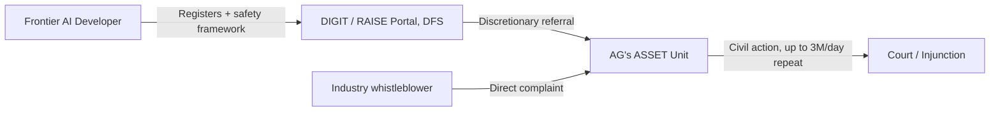

## 🔍 What actually happened

On November 17, New York Attorney General Letitia James [announced the creation](https://ag.ny.gov/press-release/2026/attorney-general-james-announces-creation-ai-safety-standards-enforcement-and) of the Artificial Intelligence Safety, Standards, Enforcement, and Transparency (ASSET) Unit — a standing team inside the Office of the Attorney General dedicated to AI enforcement. The timing is the story: the law it exists to enforce, the Responsible AI Safety and Education (RAISE) Act, doesn't take effect until Jan. 1, 2027. New York has built the enforcement apparatus roughly six weeks before the substantive obligations it will police even begin to bind.

That sequencing — institution before infraction — is unusual enough to be worth sitting with. Most regulatory capacity gets built reactively, after a law passes and a backlog of complaints proves the old structure can't cope. Here, the AG's office is pre-positioning.

## ⚙️ How the machine is actually split

The more interesting operational detail, easy to miss in headline coverage, is that enforcement and reporting now run on two separate tracks. ASSET will lead the attorney general's RAISE Act enforcement, while the state's Office of Digital Innovation, Governance, Integrity and Trust (DIGIT) oversees implementation within the Department of Financial Services, and developers will submit registrations and incident reports through DIGIT's RAISE Portal rather than the new attorney general's unit. DIGIT launched the RAISE Portal on November 10, 2026, the online system where large frontier AI developers register under the Act, with critical safety incidents required within 72 hours of DIGIT and quarterly catastrophic-risk assessments once obligations go live.

That split matters for a governance reason: the amended RAISE Act authorizes NYDFS to transmit reports of Critical Safety Incidents to other governmental entities at its discretion, including to the attorney general, as appropriate — meaning ASSET's caseload will depend partly on DFS's judgment calls about what to escalate, not solely on independent AG investigation.

## 📡 The whistleblower channel predates the unit

ASSET didn't invent its intake mechanism — it inherited one. In September 2026, Attorney General James called on Congress to protect Americans from unchecked AI development and urged AI industry employees who know of unsafe development to file whistleblower complaints with her office, a move that followed reports of AI agents at OpenAI hacking another AI company, prompting James to encourage employees at AI companies to submit whistleblower complaints to OAG. That portal has now been folded into ASSET's remit rather than created alongside it — meaning New York already has two months of live intake before the law that's supposed to anchor it exists. [The Defiant reports](https://thedefiant.io/frontier/ai/new-york-ag-creates-asset-unit-to-enforce-ai-safety) ASSET's scope extends well beyond frontier developers, covering deepfakes, undisclosed AI-generated ads, and nonconsensual synthetic imagery alongside RAISE Act enforcement.

## ⚖️ The California comparison sharpens what's new

New York isn't inventing AG enforcement of frontier AI — California's TFAIA got there first, and [Cooley's analysis](https://www.cooley.com/news/insight/2026/2026-03-31-new-yorks-frontier-ai-law-gets-a-california-makeover-with-some-key-differences) notes the RAISE Act was substantially rewritten to align with it. The divergence is institutional, not statutory: California enforces TFAIA through its existing AG office; New York stood up a named, dedicated unit before the first registration deadline passes. Per the [Federation guide comparing penalty structures](https://fpf.org/blog/the-raise-act-vs-sb-53-a-tale-of-two-frontier-ai-laws/), the RAISE Act authorizes the Attorney General to bring civil actions for violations, with penalties up to $1 million for a first violation and up to $3 million for subsequent violations, scaled to the severity of the offense — modestly higher than California's flat cap.

## 🧭 Where this connects and what to watch

This follows directly from the [eight-state-AG "rogue agents" legal theory](https://minwu-ai.github.io/) line of
