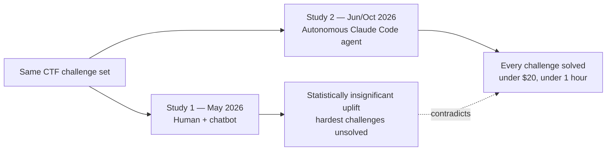

## 🔍 The finding that didn't wait five months to matter

RAND has now run the same offensive-cyber challenges twice — once with human participants aided by AI chatbots, once with an autonomous Claude Code agent — and gotten two incompatible answers about how dangerous frontier AI is for cybercrime. In the [first study](https://www.rand.org/pubs/research_reports/RRA3892-1.html), commissioned by the UK AI Security Institute, 157 participants undertook cybersecurity challenges relating to network operations, operating system exploitation, and vulnerability discovery and exploitation between September 2025 and January 2026, with the topline result that today's most advanced AI tools can help less-skilled people get started and work faster on cyberattacks, but they do not yet reliably enable them to carry out full, sophisticated attacks. In the [follow-up](https://www.rand.org/pubs/research_reports/RRA3892-2.html), RAND re-tested the same challenges with Claude Code using Sonnet and Opus 4.6, and found the AI models were able to solve each CTF challenge in under an hour with little guidance, for total API costs of less than US$20 over all CTF challenges — using straightforward prompting lacking any meaningful cyber knowledge.

That reversal is the story. The same challenge set, the same institution, the same population of difficulty — and a null result became a clean sweep once the human was taken out of the loop.

## ⚙️ What changed between the two studies

The mechanism is not mysterious: RAND's own write-up explains it was an architecture shift, not a smarter model mid-conversation. Agentic AI systems, like Claude Code, now let non-experts execute complex offensive cyberattacks, solving challenging tasks rapidly and cheaply, with human-in-the-loop uplift being outpaced by autonomous agents, lowering barriers for malicious actors. The May study measured what happens when a human still reads the model's output, decides what to try next, and executes each step. The agent study removed that bottleneck entirely — Claude Code read the challenge, planned the approach, executed commands, interpreted errors, and iterated without a person translating between the model and the machine.

This is not an isolated data point. Independent researchers running Claude Code and Codex against live CTF competitions reported a similar pattern, noting that [top teams fully automated the solving process](https://blog.includesecurity.com/2026/04/ctfs-in-the-ai-era/) with most challenges solved within minutes of release, and a parallel [Wiz/Irregular study](https://fortune.com/2026/01/29/ai-has-made-hacking-cheap-that-changes-everything-for-business/?rand=8593) found agents completing offensive security tasks for under $50 that would otherwise cost close to $100,000 in human labor. Three independently sourced results converge on the same economics: agentic deployment, not model scale, is the variable that collapses the cost and skill floor.

## 🚧 Why this breaks the regulatory instrument, not just the finding

Human uplift studies are not a side method in AI governance — they are written into the operative compliance pathway. The [EU AI Act's GPAI Code of Practice](https://artificialintelligenceact.eu/en/cop-safety/) explicitly lists human uplift studies as an accepted evaluation method for the mandatory "cyber offence" systemic-risk category that all GPAI-with-systemic-risk providers must assess, alongside Q&A sets, benchmarks, and red-teaming. That same study type is what [UK AISI commissioned from RAND](https://www.rand.org/pubs/research_reports/RRA3892-1.html) in the first place — an institution that funds and references exactly this methodology in its own threat assessments.

| | Human uplift study (May 2026) | Agentic re-test (follow-up) |
|---|---|---|
| Measures | Human decision-making with AI assist
