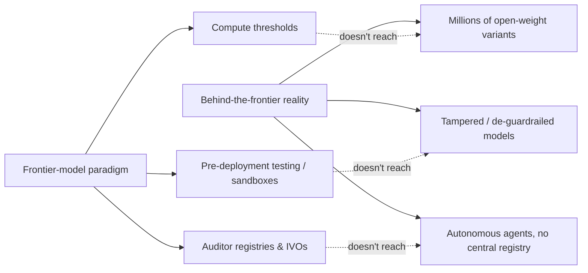

## 🎯 A credentialed insider says the target is wrong

Richard Danzig — former Secretary of the Navy and a recurring RAND voice on AI and national security — has published a Perspective that should unsettle anyone who has spent 2026 tracking frontier-model compliance regimes. His core claim: the heavy regulatory focus on frontier models misses the vast, fast-growing ecosystem behind the frontier — millions of models, agents, and applications spreading faster than any government can track. This is not a fringe critique. It's a RAND Perspective, the same imprint and author behind [RAND's earlier re-run of its own cyber-uplift study](https://minwu-ai.github.io/rand-re-ran-its-own-cyber-uplift-study-with-agents-the-human-in-the-loop-risk-model-didn-t-survive/) — making Danzig's skepticism about human-in-the-loop assumptions part of a consistent, escalating pattern from the same institution.

## 🔍 The mechanism Danzig points to

His argument rests on a reframing of where AI's danger actually comes from. AI's power is in amplifying ordinary intelligence using machine characteristics — without these characteristics, AI would be just a valued tool; with them, it is a transformative force, and behind the frontier, this force is subject to misuse, accidents, and loss of control. In plainer terms: you don't need a model approaching AGI to cause real damage. A system six months or a year behind the frontier, stripped of guardrails and run without oversight, is already dangerous because of what machines generically do — scale, replicate, and operate tirelessly — not because of exceptional intelligence.

The practical edge of this is access. Users can remove guardrails from open-weight models and operate them without oversight or even visibility. That single sentence is the whole regulatory problem in miniature: every compute-threshold or model-registration regime assumes a traceable object (a lab, a training run, a deployment). Behind the frontier, Danzig argues, that object dissolves into millions of untraceable instances.

## ⚖️ Why this cuts against the regimes the field just built

Danzig's essay lands squarely on a regulatory architecture this site has tracked for months. The [EU AI Act's first enforcement cases](https://minwu-ai.github.io/the-eu-ai-act-s-first-enforcement-test-hinges-on-whether-a-l/) are about GPAI obligations triggered by lab sandbox activity. [Italy's Decree 179](https://minwu-ai.github.io/italys-decree-1792026-is-the-ai-acts-first-working-enforcement-machine-and-it-overshoots-brussels-on-purpose/)-style enforcement machinery assigns [market surveillance powers](https://www.noze.it/en/insights/ai-decree-179-2026-gazette/) to national authorities tracking identifiable providers. And [California's AI-auditor registry](https://minwu-ai.github.io/california-s-new-ai-auditor-registry-is-real-infrastructure-/) builds an institutional layer of registered, accountable auditors — a structure that presumes there's a discrete "covered audit" of a discrete system to perform. All three regimes share an implicit unit of regulation: an identifiable model or provider that can be registered, audited, or fined. Danzig's point is that this unit is already a minority of the risk surface. A separate RAND report on open-weight biosecurity found that open-weight model platforms should implement safeguards precisely because, once released, open-weight releases are irreversible — there is no later enforcement moment to catch.

Not everyone agrees the fix is more open-weight-specific regulation. A parallel line of commentary — echoed in the [law & economics critique](https://laweconcenter.org/resources/open-models-closed-minds-ai-policy-keeps-regulating-the-wrong-thing/) of current AI policy — argues policymakers should instead preserve a healthy mix of open and proprietary models so defensive AI tools can spread widely, and recognize that firms providing access to models are often best positioned to detect and stop abuse. Danzig's position is adjacent but distinct: he isn't arguing against openness, he's arguing that governance built
