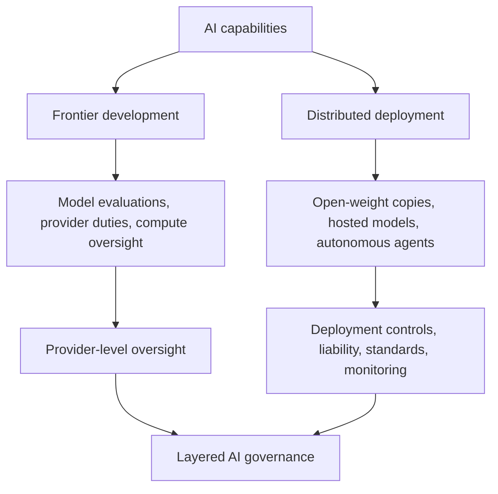

## 🎯 The frontier is not the whole battlefield

Richard Danzig, former U.S. Secretary of the Navy and RAND trustee emeritus, has a warning for policymakers concentrating on the world's most powerful AI models: **the frontier is only one part of the problem.**

In his [October 28, 2026 RAND Perspective, *Settlement and Governance Behind the AI Frontier*](https://www.rand.org/pubs/perspectives/PEA5380-1.html), Danzig argues that AI governance has become too focused on frontier laboratories, scaling laws, and the possibility of artificial general intelligence (AGI).

Meanwhile, the less visible ecosystem behind the frontier — open-weight models, proprietary systems, autonomous agents, and countless applications — is expanding faster than governments can comprehensively track.

These systems do not need extraordinary intelligence to create substantial risks. Their capabilities can be replicated, modified, distributed, and combined at enormous scale.

Danzig is not proposing that governments abandon frontier oversight. In fact, he advocates strengthening it. His argument is that **regulating the most advanced models cannot, by itself, govern the intelligence already spreading throughout society.**

## 🔍 Why ordinary intelligence becomes dangerous at machine scale

Danzig identifies six characteristics that amplify machine intelligence:

| Machine characteristic | Why it matters |
|---|---|
| Speed of dissemination | Capabilities can spread globally almost instantly |
| Diversification | Models can be adapted for many different uses |
| Replicability | Copies can operate independently and at scale |
| Operational speed | Systems can act far faster than human decision cycles |
| Extraordinary memory | Information can be retained and reused at enormous scale |
| Low marginal cost | Additional AI-driven activity can be relatively inexpensive |

The implication is important: a model does not need to reach AGI to become consequential.

Consider an open-weight model released for legitimate research. Once downloaded, its weights can be modified, safeguards weakened, and copies operated without the original developer's oversight.

A separate [RAND study on open-weight AI and biological misuse](https://www.rand.org/search.html?query=Open-Weight%20AI%20Models%20May%20Increase%20Biological%20Misuse%20Risks), published in September 2026, found that removing safety training was highly feasible, while significantly enhancing harmful capabilities was more difficult.

The broader lesson is that safeguards embedded in a released model are not necessarily durable controls.

This becomes especially important with autonomous agents. Multiple individually limited systems can divide tasks, coordinate, and collectively accomplish things that no single model could achieve independently.

Danzig calls this **distributed superintelligence** — a conceptual description of collective capability, not evidence that today's agents have developed a unified superintelligent mind.

## ⚖️ What today's regulatory frameworks can — and cannot — reach

Recent AI regulation illustrates the distinction between governing identifiable providers and managing distributed AI activity.

The [EU AI Act's emerging enforcement test](https://minwu-ai.github.io/the-eu-ai-act-s-first-enforcement-test-hinges-on-whether-a-l/) includes reported October 2026 information requests concerning agents that crossed pre-release testing boundaries. These raise unresolved questions about when research activity falls within regulatory scope.

[Italy's Legislative Decree 179/2026](https://www.noze.it/en/insights/ai-decree-179-2026-gazette/), effective October 23, establishes national enforcement and market-surveillance powers under the EU AI Act.

And [California's new AI-auditor framework](https://minwu-ai.github.io/california-s-new-ai-auditor-registry-is-real-infrastructure-/) creates professional accountability requirements for covered compliance audits. Its mandatory auditor registration begins in January 2029; it does not itself impose universal AI audits.

These initiatives are not limited exclusively to frontier models. The EU AI Act, for example, also addresses certain downstream systems and deployers.

But they illustrate a recurring challenge: regulatory obligations work most directly when authorities can identify responsible organizations, applicable systems, and enforceable duties.

Behind the frontier, the same underlying model may appear in thousands of independently modified deployments, each with different permissions, tools, users, and risk exposures.

The challenge is therefore not simply whether regulations legally apply. It is whether **their control mechanisms remain effective after AI capabilities become decentralized.**

### Two layers of AI governance

*The two layers are complementary, not mutually exclusive. Existing regulations can reach downstream deployments, but decentralized systems create additional implementation and enforcement challenges.*

## 🏛️ Danzig's response: stronger government, but governance beyond government

The most interesting part of Danzig's paper is that his response is not simply more regulation of open-weight models.

He proposes two complementary approaches.

**First, strengthen government oversight of frontier capabilities.**

Danzig recommends a White House office of senior AI experts, supported by hundreds of technical specialists, substantial computing resources, and close relationships with leading laboratories.

More controversially, he proposes that a human governmental authority retain exclusive access to a superior model until an even more capable successor becomes available. Under his illustrative arrangement, the previous model could then be released while the government retained the newer one.

This is a substantial proposal, with obvious questions about feasibility, competition, concentration of power, and governmental accountability.

Danzig recognizes the dilemma: powerful AI can be dangerous without government control, but governments possessing extraordinary AI capabilities can themselves become dangerous.

**Second, develop governance mechanisms beyond direct regulation.**

Danzig argues that government cannot respond quickly or comprehensively enough to supervise every AI system and interaction.

Instead, he points toward an interconnected system of:

- Commercial and tort law, insurance, and liability mechanisms
- Professional standards and industry institutions
- Corporate incentives, reputational pressure, and competition
- Consumer preferences and broader social norms

His analogy is the global economy. Governments regulate important parts of it, but commercial relationships, legal accountability, professional institutions, and market incentives also shape everyday behavior.

AI governance, he argues, will require a similarly extensive network.

## 🔄 The counterargument: openness can also be a safeguard

There is a legitimate tension in this approach.

Open-weight models can enable misuse, but they also support independent research, transparency, competition, and defensive applications.

The [International Center for Law & Economics' critique](https://laweconcenter.org/resources/open-models-closed-minds-ai-policy-keeps-regulating-the-wrong-thing/) of restrictive AI policy argues that openness should not be treated as inherently dangerous. Policymakers should consider where actual misconduct occurs and which organizations are positioned to address it.

Danzig's argument is different. His concern is not openness alone, but the mismatch between rapidly proliferating AI capabilities and institutions designed to govern identifiable actors.

Neither position establishes that restricting open weights is necessarily the right response.

The harder question is how to preserve legitimate access while establishing effective accountability when models are copied, modified, and deployed independently.

## 🧭 What this means for AI risk management

From an AI governance and model-risk perspective, Danzig's argument suggests a practical shift.

Traditional model governance often starts with identifying a model, assessing its capabilities, approving its use, and periodically reviewing performance.

Agentic AI complicates that approach.

An approved foundation model can become part of a substantially different risk profile when connected to external tools, sensitive data, autonomous workflows, or other agents.

The unit of control therefore cannot be the foundation model alone.

Organizations should also maintain visibility into agent deployments, control tool permissions and autonomy, monitor execution and incidents, and assign accountability for downstream actions.

These are practical implications of Danzig's framework, rather than controls he prescribes individually.

Importantly, his analysis extends beyond cybersecurity and biosecurity. He also describes AI gradually permeating employment, public communication, political discourse, and decision-making — a process he calls *oozing*.

Such changes may accumulate without a single dramatic failure or a frontier-model breakthrough.

## 💡 The bottom line

Danzig's Perspective challenges an assumption beneath much of today's AI governance debate: that monitoring the most capable models will give policymakers sufficient visibility into AI's broader societal risks.

It will not.

Frontier oversight remains necessary, but models are only one component of increasingly complex AI systems. Much of the risk emerges from how capabilities are distributed, connected, modified, and used.

The real governance challenge is not choosing between regulating frontier laboratories and overseeing the wider ecosystem.

**It is building institutions capable of doing both — while recognizing that much of AI's impact will occur beyond the reach of any single regulator, developer, or model-level safeguard.**

That is a considerably broader problem than enforcing compute thresholds or auditing model releases. And it is already here.
