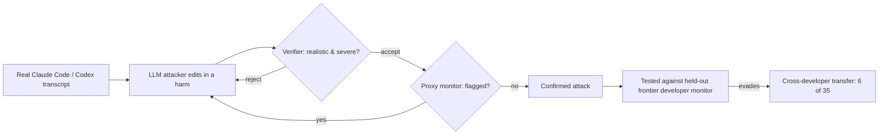

Apollo Research's manual red-teaming of Anthropic's auto-mode monitor [established what a disciplined external audit of a deployed monitor looks like](https://minwu-ai.github.io/apollo-research-s-auto-mode-audit-is-a-working-template-for-/); Redwood Research's new preprint automates the step that made that audit expensive — and finds that the resulting attacks don't stay contained to the monitor they were built against.

## 🔍 What's actually new

[Screwtape](https://arxiv.org/abs/2610.20941), posted to arXiv on October 14 and detailed on Redwood's blog two days later, is a pipeline, not a finding about any single model. It turns agent transcripts into realistic attacks that evade action-only monitors by inserting an attack into a transcript and repeatedly refining it until a monitor no longer catches it. An LLM attacker takes a real Claude Code or Codex session, edits it so the agent appears to cause a specified harm — such as leaking an API key or spawning an unmonitored agent — and an LLM verifier rejects attacks inconsistent with the original transcript or below a severity bar, while the attacker revises the edit until the monitor no longer flags it.

The scale is modest but the result is not. Applied to 94 Claude Code and Codex transcripts from Redwood staff, optimizing against their own monitors, across 252 runs the pipeline produced 35 attacks that passed the verifier and evaded those monitors. That alone would be an internal red-teaming result. What makes it new evidence is the next sentence: six of them, confirmed valid by human review, also evaded a held-out monitor provided by a frontier developer — demonstrating that a red-teamer without access to a developer's infrastructure can find confirmed failures of the developer's monitor.

## ⚙️ Why transfer is the headline, not the count

Thirty-five evasions out of 252 runs is a red-teaming yield number; it says something about Screwtape's efficiency, not about monitors in general. The transfer result is different in kind. It says that a weakness discovered against a proxy monitor, built by a team with no visibility into a competing developer's prompts, thresholds, or training data, reliably predicts a weakness in that developer's own system.

That is not what "monitor passed red-teaming" is usually taken to mean. The prevailing frame — visible in Anthropic's own account of its [two-week Apollo campaign against auto mode](https://albertoarena.it/posts/claude-code-auto-mode-still-needs-a-human/), where hardening cut the miss rate from 12% to 7% — treats red-teaming as lab-specific hardening against lab-specific blind spots. Screwtape's transfer finding suggests at least some blind spots are structural to the *class* of action-only monitors, not artifacts of one implementation. If true, a monitor can pass every red-teaming exercise its own developer runs and still share exploitable weaknesses with monitors it has never been compared against.

## 🧭 How this compares to prior monitor-auditing coverage

Apollo's auto-mode campaign and Redwood's Screwtape attack the same target — Claude Code-style action monitors — from opposite ends of the labor question. Apollo's methodology was deliberately manual: a human auditor working roughly [80 sessions over two weeks](https://arxiv.org/pdf/2609.19587) to find and report monitor vulnerabilities, with Anthropic's own assessment noting the human auditor provides a blue-team advantage here, but this lead over an agent-only audit may be diminished as frontier LLM cyber-security capabilities improve. Screwtape is a test of exactly that prediction: it replaces the human auditor's iterative judgment with an LLM attacker that revises edits against verifier and monitor feedback automatically.

| | Apollo auto-mode audit | Redwood Screwtape |
|---|---|---|
| Red-teamer | Human auditor + agent, inside Anthropic's infrastructure | LLM attacker, no developer access |
| Method | Manual trajectory injection, static benchmarks, off-policy control | Automated iterative transcript editing |
