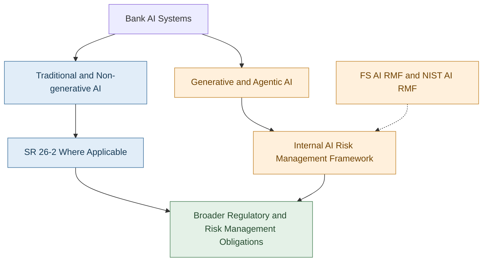
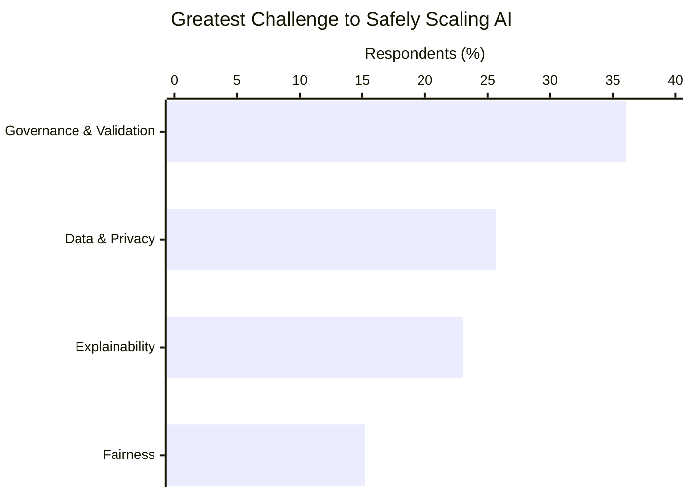

## 🔍 What banks are telling us

This site has covered the SR 26-2 carve-out twice: [when the rewrite first landed](https://minwu-ai.github.io/sr-26-2-s-genai-carve-out-creates-a-structured-governance-ga/), and again [when the shape of the governance gap became clearer](https://minwu-ai.github.io/sr-26-2-s-genai-carve-out-is-the-governance-gap-banks-must-n/).

There is another way to examine that gap: through the eyes of the institutions expected to manage it.

Wolters Kluwer's H1 2026 US Banking AI Risk and Governance Index identifies model governance and validation as the leading perceived barrier to safely scaling AI. Meanwhile, federal banking regulators have explicitly excluded generative and agentic AI from their revised model risk management guidance.

And on November 4, the OCC introduced a new AI supervisory framework for its own examiners.

Together, these developments reveal an emerging tension between regulatory flexibility and institutional readiness.

## ⚙️ The carve-out: What it does and does not mean

On April 17, 2026, the Federal Reserve, OCC, and FDIC jointly issued [SR 26-2](https://www.federalreserve.gov/supervisionreg/srletters/SR2602.htm), superseding SR 11-7 and the 2021 BSA/AML model statement, SR 21-8.

The [revised guidance](https://www.federalreserve.gov/frrs/guidance/supervisory-guidance-on-model-risk-management.htm) describes generative and agentic AI models as "novel and rapidly evolving" and states that they are "not within the scope of this guidance."

Its principles continue to apply to traditional statistical and quantitative models and non-generative, non-agentic AI models, subject to the guidance's definition of a model and institutional applicability.

However, exclusion from SR 26-2 does not mean exemption from regulatory oversight. Broader risk management responsibilities remain, and supervisory action is still possible when inadequate controls contribute to legal violations or unsafe or unsound banking practices.

Banks can draw on voluntary resources such as the [Financial Services AI Risk Management Framework (FS AI RMF)](https://home.treasury.gov/news/press-releases/sb0401) and the [NIST AI RMF](https://www.nist.gov/itl/ai-risk-management-framework), although neither is formally designated as a replacement for SR 26-2.

*Figure 1. The scope of SR 26-2 and the continuing applicability of broader risk management obligations. Author's interpretation.*

The distinction matters: the agencies have narrowed the scope of dedicated model risk guidance, not eliminated responsibility for managing AI risk.

## 📊 What banking professionals say actually blocks them

The [US Banking AI Risk and Governance Index](https://assets.contenthub.wolterskluwer.com/api/public/content/3333242-us-banking-ai-risk-and-governance-index-3e8245da37), based on an April 2026 survey of 230 US banking professionals, asked respondents to identify their greatest challenge to safely scaling AI.

The results are revealing.

| Greatest challenge to safely scaling AI | Share of respondents |
|---|---:|
| **Model governance and validation** | **36.09%** |
| Data quality and privacy | 25.65% |
| Transparency and explainability | 23.04% |
| Fairness and non-discrimination | 15.22% |

*Figure 2. Perceived barriers to safely scaling AI. Source: Wolters Kluwer, Trusted AI Survey, April 2026, p. 4.*

Governance and validation lead by more than 10 percentage points over data quality and privacy, and receive approximately 2.37 times the share of responses identifying fairness and non-discrimination.

These results represent practitioners' perceptions rather than independently measured constraints. Nevertheless, they suggest that institutional governance capabilities are an important limiting factor in AI adoption.

## ⚖️ Governance comes first, but fairness still matters

The same survey asked a different question: which controls most urgently need strengthening to reduce AI-related risk?

The ranking changes.

| Most urgent control investment | Share of respondents |
|---|---:|
| **Enhanced fairness and bias controls** | **28.63%** |
| Continuous monitoring and performance management | 26.87% |
| Model governance and validation | 22.91% |
| Data controls and privacy assurance | 21.59% |

*Source: Wolters Kluwer, Trusted AI Survey, April 2026, p. 6.*

These findings are not contradictory. Governance can be the greatest structural barrier to scaling AI, while fairness represents the most urgent area of control improvement.

An institution needs the ability to identify its AI systems, evaluate their behavior, establish accountability, and monitor changes before it can reliably demonstrate that individual risk controls work.

Governance is not an alternative to fairness, explainability, or privacy. It is the infrastructure through which those objectives become operational and auditable.

## 🤖 Where agentic AI makes the problem harder

The survey also examines where agentic AI introduces the greatest risk when automation operates without sufficient human oversight.

| Business function | Share of respondents |
|---|---:|
| Lending and underwriting | 33.04% |
| Collections and recovery | 30.43% |
| Fraud and payments | 23.91% |
| No deployment yet | 12.61% |

*Source: Wolters Kluwer, Trusted AI Survey, April 2026, p. 10.*

Nearly two-thirds of responses identify lending, underwriting, or collections and recovery.

These are consequential customer-facing activities where an inappropriate action can create financial, legal, and reputational exposure.

Unlike a conventional predictive model, an AI agent may interpret instructions, access external information, select tools, and execute multiple actions before producing a final outcome.

Validating the accuracy of that outcome alone may not establish whether the underlying actions were authorized, appropriate, or compliant.

The object of validation is no longer just a model. It is an entire system of behavior.

## 🏛️ The OCC's November framework: A shift in supervision

On November 4, 2026, the OCC issued [Bulletin 2026-54](https://www.occ.gov/news-issuances/bulletins/2026/bulletin-2026-54.html) and an accompanying [supervisory framework](https://www.occ.gov/news-issuances/news-releases/2026/nr-occ-2026-97a.pdf) to help examiners assess banks' use of AI, referred to in the publication as Super Intelligence (SI).

The framework does not establish new regulatory requirements or require banks to create a separate AI risk category.

Instead, it directs examiners toward risk-based assessments that consider:

- The potential consequences of AI failure or misuse.
- The degree of autonomy delegated to an AI system.
- The extent of human oversight.
- The materiality and complexity of individual use cases.

This is consistent with the direction Federal Reserve Vice Chair for Supervision Michelle Bowman outlined in her [May 1 remarks](https://www.federalreserve.gov/newsevents/speech/bowman20260501a.htm) on adapting supervision to evolving AI technologies.

The regulatory direction is becoming clearer: integrate AI risks into existing risk management disciplines, while adapting supervisory assessments to the characteristics of the technology.

The November framework does not reverse SR 26-2's carve-out. But it makes clear that exclusion from traditional model risk guidance should not be interpreted as exclusion from supervisory attention.

## 🧱 What follows for practitioners

Four practical implications stand out.

**1. Establish a common AI inventory.**  
Maintain visibility across traditional models, foundation models, copilots, and autonomous agents. Document classification decisions, ownership, materiality, autonomy, and system dependencies.

**2. Extend validation beyond model outputs.**  
Independent assessment should consider hallucination, adversarial robustness, tool-use behavior, authorization boundaries, policy compliance, and human intervention, proportionate to the risks of each use case.

**3. Treat foundation model changes as risk events.**  
Third-party model upgrades can alter system behavior without corresponding changes to the bank's application code. Version tracking, regression testing, controlled rollout, and rollback capabilities should become part of the assurance lifecycle.

**4. Integrate AI governance into existing accountability structures.**  
Model risk management, operational risk, technology risk, compliance, and internal audit should operate through coordinated responsibilities rather than fragmented or duplicative assessments.

The objective is not necessarily to create another risk management silo. It is to ensure that existing disciplines collectively address risks they were not originally designed to evaluate.

## 💡 The real governance gap

There is a defensible reason for regulators to avoid imposing a rigid validation methodology on rapidly evolving technologies.

But regulatory flexibility is not the same as institutional readiness.

The April survey shows that banking professionals already perceive governance and validation as a leading constraint on AI expansion. The November OCC framework reinforces that AI remains a subject of supervisory attention, even without a dedicated interagency validation standard for generative and agentic systems.

The challenge for banks is therefore not whether to govern AI, but how to demonstrate that their governance is effective.

SR 26-2 gives institutions greater flexibility to answer that question. It does not answer it for them.

**The absence of a common supervisory blueprint makes credible internal assurance more important, not less.**
