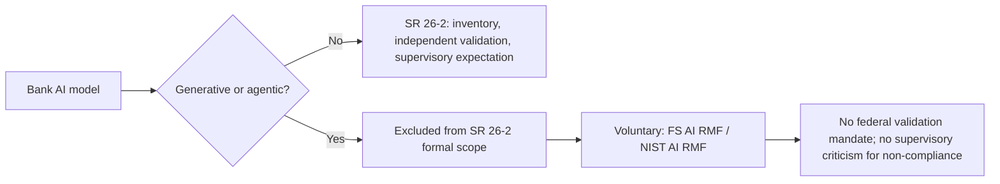

## 🔍 What has actually changed since June

This site has covered the SR 26-2 carve-out twice: [when the rewrite first landed](https://minwu-ai.github.io/sr-26-2-s-genai-carve-out-creates-a-structured-governance-ga/), and again [when the shape of the gap banks have to fill themselves became clearer](https://minwu-ai.github.io/sr-26-2-s-genai-carve-out-is-the-governance-gap-banks-must-n/). The mechanism has not changed, and this post does not re-argue it.

What is new is evidence from the other side of the problem. Banks have now been asked, at scale, what actually blocks them from scaling AI. Their answer lands exactly on the part the regulation declines to cover.

## ⚙️ The carve-out in one paragraph

On April 17, 2026, the Federal Reserve, OCC, and FDIC jointly issued [SR 26-2](https://www.enz.ai/glossary/sr-26-2), superseding SR 11-7 — the guidance banks had operated under for fifteen years — and the 2021 BSA/AML model statement, SR 21-8. The guidance states that generative and agentic AI models "are novel and rapidly evolving" and "are not within the scope of this guidance," while confirming that its principles do apply to traditional statistical and quantitative models and to non-generative, non-agentic AI.

This is not a prohibition. It is a scope decision, and the destination for everything outside that scope is voluntary: the FS AI RMF or the NIST AI RMF, supported by an AI inventory covering both populations. Neither carries SR 26-2's supervisory weight. The guidance is explicit that it "does not set forth enforceable standards or prescriptive requirements; accordingly, non-compliance with this guidance will not result in supervisory criticism."

## 📊 What banks say actually blocks them

The [Trusted AI Survey](https://assets.contenthub.wolterskluwer.com/api/public/content/3333242-us-banking-ai-risk-and-governance-index-3e8245da37) (April 2026, 230 banking professionals) asked which trusted-AI risk factor represents the greatest challenge to safely scaling AI across banking functions. The answers:

| Barrier | Share of respondents |
|---|---|
| **Model governance and validation** | **36.09%** |
| Data quality and privacy | 25.65% |
| Transparency and explainability | 23.04% |
| Fairness and non-discrimination | 15.22% |

Governance leads decisively — cited by more than one in three respondents, and nearly **double** the share naming fairness and non-discrimination, the risk category a decade of regulatory attention and vendor tooling has been built around.

This is not practitioners saying fairness does not matter. It is practitioners saying governance mechanics come first: you cannot meaningfully assess a model's fairness before you can inventory it, validate it, and show your work.

## 🧭 The collision

Put the two findings next to each other.

The barrier banks name most often is model governance and validation. That is the precise function SR 26-2 governs — and the precise function it removes from formal scope for generative and agentic AI, which is the category banks are deploying fastest.

So the federal validation mandate covers the models where governance is a solved problem, and declines to cover the models where banks themselves say governance is the binding constraint. The guidance is strongest exactly where it is needed least.

That inversion is the story. It is not an accusation of bad drafting: the agencies' stated reason — that these systems are novel and rapidly evolving — is a defensible basis for not writing prescriptive rules you would have to rewrite within a year. But a defensible reason for declining to prescribe is not the same as an answer to the problem, and the survey makes the size of the unanswered part measurable for the first time.

## 🧱 What follows for practitioners

Three consequences, in rough order of how soon they bite.

**The voluntary framework is now the operative one.** For the fastest-growing AI population in a bank, the FS AI RMF or NIST AI RMF is not a supplement to the supervisory baseline — it *is* the baseline. It should be resourced accordingly, not treated as a side document.

**Scope boundaries become a control.** If a model's treatment depends on whether it is "generative or agentic," then the classification decision deserves the same rigor as a validation: written criteria, a named owner, and a record of borderline calls. An unexamined label is now load-bearing.

**Absence of supervisory criticism is not absence of risk.** SR 26-2 says non-compliance will not draw criticism. That is a statement about examiner behavior, not about whether a model fails in production. The institutions that read it as relief and the ones that read it as a delegation will diverge slowly, then visibly.

Banks have told their own industry what is hardest. The guidance that governs that exact discipline has drawn its boundary just short of where the hard part now lives. Closing that distance is no longer a regulatory question. It is a choice each institution makes on its own.
