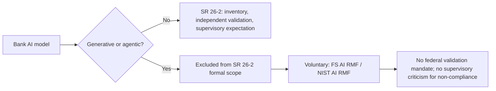

## 🔍 What's confirmed since the last check-in

[Prior coverage on this site](https://minwu-ai.github.io/the-newest-bank-supervisory-playbook-explicitly-doesn-t-cover-the-newest-risk/) flagged that the Fed, OCC, and FDIC's April 2026 rewrite of bank model-risk guidance left generative and agentic AI out of scope. What's new is how consistently that reading now holds up across independent sources that have had months to parse the actual text — removing any doubt that this was an ambiguous drafting choice rather than a deliberate boundary.

The regulatory mechanics are no longer in dispute. On April 17, 2026, the Federal Reserve, OCC, and FDIC jointly issued [SR 26-2](https://www.enz.ai/glossary/sr-26-2), superseding SR 11-7 — the 2011 guidance banks had operated under for fifteen years — and the 2021 BSA/AML model statement, SR 21-8. Multiple compliance trackers reading the primary text converge on the same language: the guidance states that generative and agentic AI models "are novel and rapidly evolving" and "are not within the scope of this guidance," while confirming that its principles do apply to traditional statistical and quantitative models and to non-generative, non-agentic AI models.

## ⚙️ The mechanism: scope, not prohibition

This is not banks being told agentic systems are ungoverned — it's banks being told the federal validation mandate simply doesn't apply to them. One tracker summarizes the operative instruction plainly: the agencies add that a banking organization's risk management and governance practices should still guide the controls applied to any tool, process or system the document does not cover. A second independent source frames the resulting burden-shift directly: the regulators aren't saying GenAI and agentic AI are unregulated — they're saying the specific technical requirements in SR 26-2 weren't built for them, and banks are on the hook for filling that gap themselves.

The practical destination for that gap-filling is consistent across sources: the effect is to push generative and agentic AI into a separate framework, commonly the FS AI RMF or the NIST AI RMF, supported by an AI inventory that covers both populations. Both are voluntary. Neither carries SR 26-2's supervisory weight, and SR 26-2 itself now states explicitly that "this guidance does not set forth enforceable standards or prescriptive requirements; accordingly, non-compliance with this guidance will not result in supervisory criticism against a banking organization."

## 🧭 The new synthesis: governance is the acknowledged bottleneck, and it's the uncovered part

Here is the connection that wasn't fully visible in October. Industry's own measurement of what blocks AI scaling in banking doesn't point to fairness or explainability — the risks regulatory conversations have spent a decade building tooling around. A 230-respondent [Trusted AI Survey reported by Wolters Kluwer](https://assets.contenthub.wolterskluwer.com/api/public/content/3333242-us-banking-ai-risk-and-governance-index-3e8245da37) found model governance and validation is the top barrier, with model governance and validation leading decisively at 36.09 percent. [eMarketer's independent write-up](https://www.emarketer.com/content/banks-ai-adoption-moving-faster-than-guardrails) of the same data confirms the magnitude: the study found that 36.1% of banking professionals cited model governance and validation as the top barrier to safely scaling AI—by far the leading concern.

That is precisely the category SR 26-2 pulls out of its own formal, examiner-backed scope for the AI banks are deploying fastest. One compliance glossary states the gap bluntly: the stack's one structural gap is the agent — SR 26-2 is the clearest evidence: the newest model-risk guidance names generative and ag
