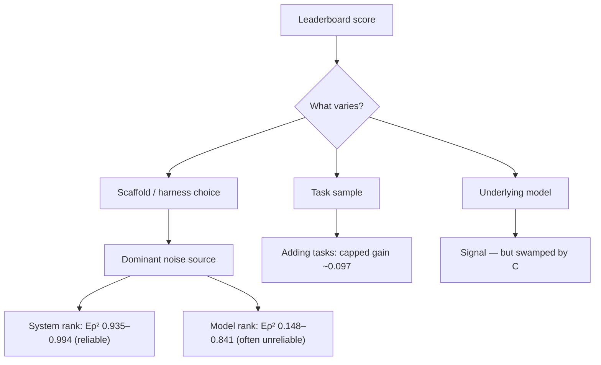

## 🔍 The new result

A [Stanford/UIUC preprint](https://arxiv.org/abs/2610.00651) posted September 30 puts a number on something practitioners have long suspected but rarely could quantify: agent leaderboards are not measuring what most people think they're measuring. This piece builds on the throughline laid out in [The Evaluation Stack Is Breaking in Three Places at Once](https://minwu-ai.github.io/the-evaluation-stack-is-breaking-in-three-places-at-once/), which named benchmark saturation as one of three structural failures in the evidentiary chain — but that post didn't have the mathematics to show *why* adding more tasks can't fix it. This one does.

The authors — Michael Hardy, Ruhana Azam, Anka Reuel, Mykel Kochenderfer, and Sanmi Koyejo — develop a Bayesian variance-decomposition framework for sparse, imbalanced agent leaderboards and apply it to 22 benchmarks from the Holistic Agent Leaderboard and Harbor Index, separating signal — performance differences relevant to the intended claim — from noise — irrelevant variation that can still change rankings. The headline distinction: an evaluation that reliably ranks deployed systems may not reliably rank underlying models.

## ⚙️ What the numbers actually say

The gap is not subtle. Fixed model-scaffold systems are ranked reliably (0.935-0.994), while underlying-model reliability is substantially lower (0.148-0.841). In plain terms: if your claim is "Harness X built on Model Y is a good product," these 22 benchmarks largely support that claim. If your claim is "Model Y is better than Model Z," the same benchmarks often cannot support it.

The more structurally important finding is about what *can't* fix this. More tasks cannot resolve all uncertainty — even infinitely many similarly constructed tasks improve model-ranking reliability of a benchmark by at most 0.097 when uncertainty is dominated by limited scaffold coverage. That's a hard mathematical ceiling, not a budget problem. Throwing money at bigger test suites — the industry's default response to benchmark saturation — does nothing if the noise is coming from which scaffold happened to wrap each model, not from too few questions.

There is one genuine fix the paper identifies, and it cuts against adding more tasks within a single benchmark: pooling across diverse benchmarks. Pooling diverse benchmarks can improve cross-task rankings at lower cost, with one analysis showing pooling diverse benchmarks 0.44→0.75 can cut projected cost ~83%.

## 🧭 Where this sits against prior coverage

This result sharpens two things this site has already flagged. [Scale AI's READY framework](https://minwu-ai.github.io/scale-ai-s-ready-framework-asks-the-question-leaderboards-ca/) showed that near-tied accuracy scores can hide large differences in human-review cost — a reliability cost orthogonal to accuracy. [Princeton's reliability scorecard](https://minwu-ai.github.io/the-reliability-gap-your-agent-passed-the-benchmark/) showed capability gains without reliability gains across two years. Neither post, however, established that the ranking instability itself is attributable to a specific, named variance component — scaffold coverage — that no amount of task-scaling addresses. That is the genuinely new contribution: a diagnosis with a mathematical ceiling attached, not just another symptom.

## 🧱 The governance implication

Enterprises routinely cite leaderboard position as evidence in model-selection memos, vendor RFPs, and procurement justifications. This paper implies that practice is frequently citing the wrong claim. A rank on HAL or Harbor is strong evidence about a specific scaffold-model pairing someone else built — it is weak evidence about whether switching the underlying model, inside your own harness, will reproduce that rank.

| Claim being cited | Reliability on these benchmarks |
|---|---|
| "This deployed system (scaffold + model) ranks well" | High (Eρ² 0.94–0.99) |
| "This
