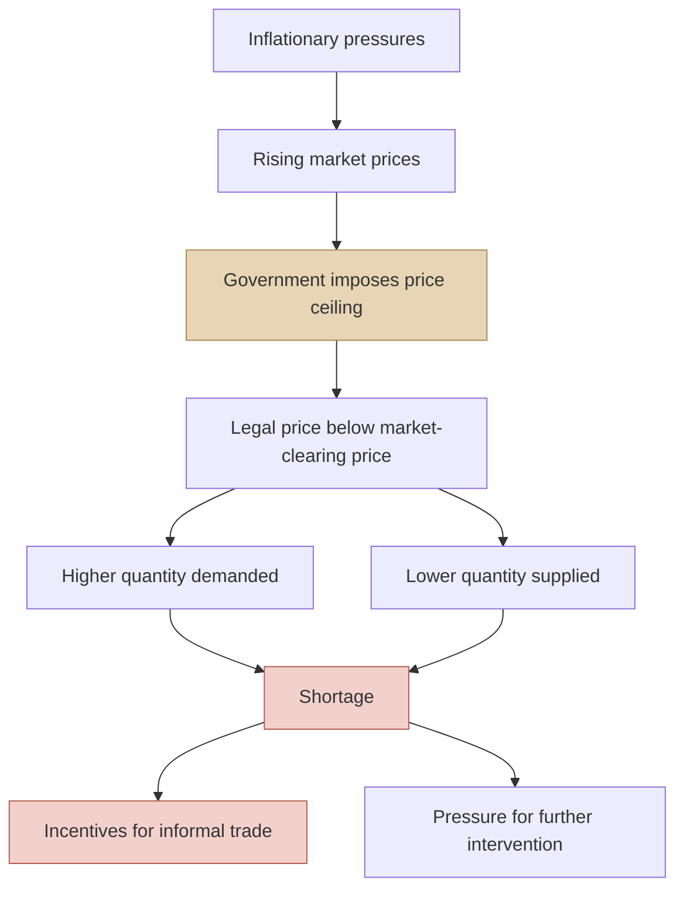

## 📜 An emperor who tried to legislate the economy

In 301 CE, the Roman Empire issued one of the most ambitious pieces of economic legislation in the ancient world. It established [maximum prices for more than a thousand goods and services](https://en.wikipedia.org/wiki/Edict_on_Maximum_Prices) — wheat, wine, pork, shoes, hairdressing, a day's wage for a mason, and even the cost of transporting cargo across the Mediterranean.

More than forty fragmentary copies have survived, all from the eastern empire. The most complete surviving copy, inscribed on the Civil Basilica at Aphrodisias in modern-day Turkey, preserves approximately 40% of the original text, according to a [2024 scholarly review of Michael Crawford's archaeological work](https://bmcr.brynmawr.edu/2024/2024.07.21/).

The scale of the inscription alone tells us something about the government's regulatory ambitions.

The man behind it, Emperor Diocletian, was not a casual ruler improvising a decree. He had spent nearly two decades rebuilding an empire that had come dangerously close to disintegration.

His price edict would become one of the most enduring historical examples of the difference between possessing power and achieving control.

## 🏛️ Building the Roman administrative machine

When Diocletian came to power in 284 CE, Rome had endured decades of civil wars, foreign invasions, political assassinations, and monetary instability.

His response was institutional reform on an extraordinary scale.

In 293, he established the Tetrarchy, dividing imperial authority among four emperors. During his reign, the number of provinces roughly doubled, and provinces were organized into larger administrative units known as dioceses.

He also reorganized taxation and introduced more systematic assessments of land and population to support the empire's fiscal and military needs.

| Dimension | Before Diocletian | Under Diocletian |
|---|---|---|
| Imperial leadership | Typically a single emperor | Four co-emperors |
| Provincial administration | Approximately 50 provinces | Approximately 100 provinces |
| Administrative hierarchy | Relatively fewer layers | Provinces, dioceses, and imperial authorities |
| Taxation | Less standardized assessments | More systematic fiscal assessments |
| Imperial presence | Less geographically distributed | Multiple imperial centers near strategic frontiers |

These reforms expanded the government's ability to collect information, mobilize resources, and implement policy across an enormous territory.

By the standards of the ancient world, it was a remarkable administrative achievement.

But the ability to assess taxable resources was not necessarily the ability to understand the behavior of an economy.

## 🪙 A currency losing its credibility

For much of the third century, Roman emperors struggling to finance military expenditure had progressively debased their silver coinage.

The antoninianus, introduced under Caracalla in 215 CE as a coin nominally worth two denarii, underwent a dramatic deterioration in its precious-metal content.

By the late third century, some issues contained only a few percent of silver, effectively becoming copper-alloy coins with a silvered surface.

[Modern metallurgical research](https://iris.uniroma1.it/retrieve/4a57d6f4-0771-4d21-abea-5448d5cac7a4/Pagano_Archaeometric-characterisation_2023.pdf) confirms the substantial reduction in precious-metal content during this period.

Currency debasement interacted with military expenditure, political instability, and disruptions to economic activity, contributing to severe inflationary pressures.

Diocletian understood that Rome had a monetary problem. Around 294, he introduced a reformed coinage system, including new silver and base-metal denominations. Further currency revaluation followed in 301.

The maximum-price edict was therefore not an isolated intervention. It formed part of a broader attempt to restore economic stability, although the precise sequence and relationship between the measures remain debated.

| Year | Event |
|---|---|
| 215 | Caracalla introduces the antoninianus |
| 250s–270s | Severe deterioration of silver coinage |
| 284 | Diocletian becomes emperor |
| 293 | Establishment of the Tetrarchy |
| c. 294 | Major monetary reform |
| 301 | Currency revaluation and Edict on Maximum Prices |
| Subsequent years | Price controls reportedly abandoned |

When monetary and fiscal reforms proved insufficient to resolve the wider economic problem, the imperial government deployed another instrument: its authority to regulate prices.

## ⚖️ When a price becomes a legal command

The edict's preamble presents excessive prices primarily as a problem of human greed, condemning those who exploited scarcity and economic hardship for personal gain.

Its enforcement provisions were severe.

As the surviving [English translation of the edict](https://kark.uib.no/antikk/dias/priceedict.pdf) shows, selling above the prescribed maximum could carry the death penalty. Punishment also extended to buyers participating in prohibited transactions and those deliberately withholding goods from sale.

The government was attempting to protect consumers, including soldiers whose purchasing power was threatened by rising prices.

But declaring a maximum price does not eliminate the economic circumstances that produced it.

Under a conventional supply-and-demand model, a binding price ceiling creates a gap between the quantity consumers wish to purchase and the quantity suppliers are willing to provide.

*Illustration: The potential economic consequences of a binding price ceiling. This is a conceptual model, not a reconstruction of Roman market data.*

If the legal price is insufficient to compensate merchants for their costs and risks, more aggressive enforcement can make participation in the legal market even less attractive.

The government may succeed in suppressing a visible price without improving the availability of the goods themselves.

## 📉 What happened to the Roman marketplace?

The most famous account of the edict's consequences comes from Lactantius, an early Christian writer.

In Chapter VII of [On the Deaths of the Persecutors](https://en.wikisource.org/wiki/Ante-Nicene_Fathers/Volume_VII/Lactantius/Of_the_Manner_in_Which_the_Persecutors_Died/Chap._VII), he describes bloodshed, goods disappearing from sale, worsening scarcity, and the eventual abandonment of the law.

His account requires caution. Lactantius was openly hostile to Diocletian, whose reign included the persecution of Christians. He was not conducting an impartial economic assessment.

Historians also lack comprehensive records establishing how consistently the edict was enforced, particularly in the western empire, or precisely when enforcement ceased.

As historian Simon Corcoran discusses in [The Prices Edict](https://academic.oup.com/book/47281/chapter-abstract/422652533), questions surrounding the legislation's implementation and effectiveness remain important to understanding the episode.

Nevertheless, the surviving testimony describes a recognizable economic mechanism: an intervention that changed the incentives of market participants without necessarily resolving the conditions that produced high prices.

The evidence of regulatory ambition is carved in stone. The evidence of its effectiveness is considerably less complete.

## 🔍 The illusion of control

What makes this episode more than a conventional argument against price controls is the institutional context.

Diocletian was arguably one of Rome's most capable administrative reformers. Many of his reforms outlasted his reign and shaped the organization of the later Roman Empire.

Yet administrative sophistication did not guarantee economic effectiveness.

There are three distinct capabilities that institutions frequently confuse:

| Capability | Fundamental question |
|---|---|
| **Observability** | Can we see what is happening? |
| **Enforceability** | Can we compel compliance with our rules? |
| **Controllability** | Can we achieve the intended outcome? |

*Illustration: Three distinct dimensions of institutional capacity.*

Diocletian's reforms expanded Rome's administrative visibility and its potential enforcement capacity. But a census of taxable land was not a real-time picture of market conditions. A network of provincial governors was not a mechanism for eliminating scarcity.

And a legally compliant price was not necessarily evidence of a healthy economy.

The distinction remains relevant today. Governments, corporations, and financial institutions increasingly invest in monitoring systems, reporting infrastructure, compliance mechanisms, and automated controls.

All of these can improve institutional capabilities. None, by itself, establishes that an intervention is producing its intended outcome.

The danger arises when institutions begin treating the metrics they can enforce as substitutes for the outcomes they actually care about.

## 💡 Final thoughts

Diocletian retired voluntarily in 305 CE, leaving behind an empire substantially reorganized by his reforms.

His legacy was not simply one of economic failure. It was also one of institutional innovation, administrative sophistication, and political stabilization.

That is precisely what makes his price edict worth remembering.

An institution does not need to be incompetent to design an ineffective intervention. It can possess extraordinary resources, sophisticated administrative infrastructure, and extensive legal authority — and still misunderstand how the system it governs will respond.

Stronger enforcement can make a well-designed policy more effective. It can also magnify the unintended consequences of a poorly designed one.

The ultimate test of a control is not whether the rule is obeyed.

It is whether the intended outcome is achieved.
