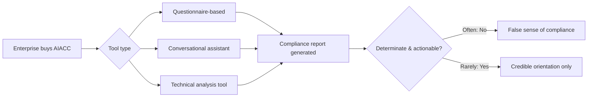

A compliance tool that tells you what you want to hear is worse than no tool at all, because it replaces uncertainty with false confidence. That is the uncomfortable implication of the [first empirical study](https://arxiv.org/abs/2609.36228) of automated EU AI Act compliance checkers, published September 28 by researchers at the Technical University of Munich, Australian National University, and collaborators. The paper tested the actual category of software that a fast-growing market of enterprises is buying into right now — and found it wanting.

## What the study actually did

The researchers characterize 12 mainstream AIACCs across multiple dimensions, evaluate their legal coverage and alignment, and analyze checker-generated compliance reports for structure, determinacy, and actionability. This matters because, as the authors note, stakeholders such as small-to-medium businesses and individual developers often lack the legal expertise required to interpret these obligations and translate them into engineering and governance practices, creating a disconnect that may lead to missing safeguards or misdirected development efforts. The tools exist precisely to close that gap — by claiming to streamline compliance assessments and provide practical guidance.

The verdict is blunt. The quality of AIACCs varies significantly and they currently can only serve as early-stage orientation tools — the researchers observe inconsistent interaction modes and user-friendliness, a tendency to overly simplify or omit key obligations, and a failure to provide determinate, actionable guidance. As a result, reliance on the current generation of AIACCs may foster a false sense of compliance. That phrase — a false sense of compliance — is the headline risk, and it deserves to be read as a governance warning, not just an academic critique.

The tools span five provider groups and multiple interaction paradigms — dynamic-branching questionnaires, fixed questionnaires, conversational assistants, and technical analysis tools. That diversity of form is itself a finding: there is no converged standard for what a "compliance check" under the AI Act should even look like.

## The gap between the market and the evidence

This finding lands squarely inside a compliance-software market that has grown explosively around the AI Act's phased deadlines. Industry analysis puts the [EU AI Act compliance software market](https://www.mordorintelligence.com/industry-reports/eu-ai-act-compliance-software-market) at roughly $1.14 billion in 2026, with a forecast CAGR above 28%, and buyer's guides now [compare over 20 vendors](https://www.modulos.ai/best-ai-governance-platforms/) spanning enterprise governance platforms, multi-framework GRC suites, and specialized AI Act point solutions. That same guidance candidly admits the core problem the TU Munich paper quantifies: every vendor now claims the same thing — "end-to-end governance," "continuous monitoring," "EU AI Act compliance" — but the actual product behind those claims varies by orders of magnitude.

Buyer confusion compounds the problem. One recent market guide observes that shopping for "EU AI Act software" produces a confusing shortlist because two different product families answer to the same keyword — program/documentation tools versus technical testing and runtime-enforcement tools. None of that market segmentation addresses what the TU Munich researchers actually measured: whether the outputs of these tools are legally defensible artifacts or just well-formatted guesses.

## Why "early-stage orientation" is the right frame — and the wrong one for procurement

The researchers are careful to position AIACCs as orientation aids, not certification instruments — language that is honest about the current state of the art but dangerous when lost in vendor marketing. This is the same structural tension explored in [Colorado's AI Governance Retreat](https://minwu-ai.github.io/colorado-s-ai-governance-retreat-what-sb-26-189-means-for-ev/): compliance regimes built on documentation and self-attestation are only as credible as the tooling that generates the documentation. If the underlying checker cannot reliably map a system to the correct Annex III category or surface Article 14 human-oversight duties, the resul
