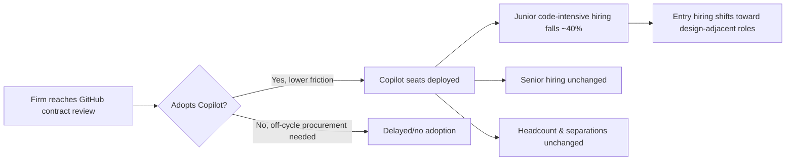

## 🔍 A Natural Experiment Hiding in GitHub's Sales Calendar

Most AI-and-jobs research has a built-in flaw: firms that adopt AI early are different from firms that don't, so any hiring gap could reflect that selection rather than the tool itself. A new preprint from [Lindsey Raymond (MIT) and Eleanor Dillon (Microsoft Research)](https://arxiv.org/abs/2611.31083) gets around this by exploiting something mundane — the fact that GitHub Enterprise customers have pre-scheduled contract renewal dates set before Copilot ever existed. Firms reaching that calendar date faced lower friction to add Copilot seats than firms that would have had to open an off-cycle procurement process, and the paper reports that a year after its review, a firm was about 19 percentage points more likely to have adopted Copilot than firms still waiting for theirs. That timing variation, uncorrelated with a firm's underlying demand for engineers, is the instrument that lets the authors claim causality rather than mere correlation.

The sample is not small: 5,414 multinational firms accounting for 38% of the U.S. programming workforce, with data running from 2021 through mid-2025. This is the first large-scale causal labor-demand evidence tied to enterprise AI coding-tool adoption — distinct from the usage-and-spend questions this site has previously tracked in [Google's ATLAS usage study](https://minwu-ai.github.io/google-s-atlas-v1-0-15-million-interactions-show-ai-adoption/) and the [Menlo enterprise-spend report](https://minwu-ai.github.io/menlo-s-400-company-survey-shows-enterprise-ai-spend-concent/), neither of which addressed hiring composition.

## ⚙️ What the Instrument Actually Found

The headline numbers, once you let the natural experiment run:

| Metric | Effect |
|---|---|
| Overall quarterly technical hiring | cut quarterly technical hiring by 29%, mostly in junior roles |
| Junior software engineer hiring | reduces quarterly junior software engineering hiring by approximately 40% |
| Experienced software engineer hiring | no detectable decline among experienced software engineers (-0.160 log points) |
| Separations / total headcount | no reported effect on separations, overall technical headcount, or vacancy duration |

Before Copilot, 72% of junior technical hires entered code-intensive roles; our estimates imply that adoption reduces this share to 52% — entry-level hiring is being redirected toward roles with less raw coding content, not eliminated outright. The authors interpret the mechanism plainly: GitHub Copilot substitutes more readily for the coding tasks performed by junior workers than for those bundled into experienced roles.

## ⚖️ Why This Complicates the Productivity Story

The finding that should unsettle anyone reading AI-productivity studies at face value: the firms aren't acting on who benefits most from the tool. Experimental work has repeatedly shown novices gain the most from AI coding assistance task-by-task — and the authors confront that tension directly, writing that even when generative AI provides the largest task-level productivity boost to novices, those individual gains need not translate into greater labor demand. Firms appear to be optimizing for which tasks are separable and substitutable, not which workers improve fastest. That is a governance-relevant distinction: a tool can pass every task-level evaluation for junior-level uplift and still shrink the junior labor market, because substitutability — not individual gain — is what drives the hiring margin.

The authors are also careful about what their design can and cannot show. This is a preprint, not yet peer-reviewed, and it studies one tool's rollout inside a macro environment already hostile to junior tech hiring — GitHub Copilot launched during a sharp macroeconomic
