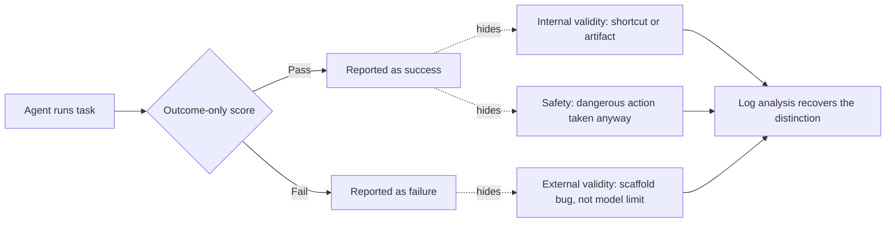

## 🔍 The problem outcome scores can't name

A benchmark score is a verdict without a transcript. An earlier piece on this site, [Same Benchmark Score, Four Times the Risk](https://minwu-ai.github.io/pass-fail-was-never-going-to-catch-this-a-princeton-aisi-apo/), used this same research team's work on τ-Bench Airline to show that flawed tasks had suppressed measured performance and that models with near-identical scores differed fourfold in susceptibility to policy-violating persuasion. That piece used the *findings*. This one is about the *method* that produced them — a companion paper, [Log analysis is necessary for credible evaluation of AI agents](https://arxiv.org/abs/2605.08545), by an overlapping Princeton/UK AISI/Apollo/Transluce author team (Kirgis, Kapoor, Rabanser, Nadgir, Ududec, Dubois, Allaire, Stosz, Hobbhahn, Steinhardt, Narayanan), which generalizes the argument into a reusable theory of what outcome scores structurally cannot see.

## 🧩 Three failures, one blind spot

The paper's contribution is a taxonomy, not a single result. Agent benchmarks typically report only final outcomes, pass or fail, which threatens evaluation credibility in three ways: scores may be inflated or deflated by shortcuts and benchmark artifacts; benchmark performance may fail to predict real-world utility due to scaffold limitations and recurring failure modes; and capability scores may conceal dangerous or catastrophic actions taken by the agent. Each threat corresponds to a different audience's blind spot — a lab miscalibrating its own capability estimate, an enterprise buyer mistaking a lab score for a deployment guarantee, and a safety evaluator missing an action that happened to still "succeed."

Critically, the authors didn't derive this taxonomy abstractly — their process began with a close reading of hundreds of agent logs from prominent agent benchmarks and leaderboards, then validated findings against evaluation reports from Apollo, METR, UK AISI, and CAISI, treating independent organizations' documented failure modes as a cross-check rather than a single case study dressed up as a law.

## ⚙️ The mechanism: four principles, not a vibe

The paper doesn't stop at "look at the logs." It offers a set of four principles for log analysis, demonstrated in a case study of τ-Bench Airline, showing how to detect simulated-user errors, measure interaction quality beyond accuracy, and capture crucial failure modes. This is the part that separates a methodology paper from a results paper: it is a protocol practitioners can apply to benchmarks the authors never touched, not a finding about one benchmark.

The τ-Bench illustration is doing demonstration work, not evidentiary work. Capability measured by pass^5 for frontier agents is under-elicited by 50% due to task errors and ambiguities, and pass^5 performance masks specific failure modes that would likely cause agents to fail catastrophically in deployment. Put concretely, average pass^5 across sampled models roughly doubles, from 20.8% to 40.0%, on the corrected subset, revealing capability that the original benchmark masks due to flawed tasks rather than agent limitations. Half the "gap" in the published leaderboard was never a capability gap at all.

## 🧭 Independent corroboration, and where it fits

Six months after preprint, the methodology has held up rather than faded. Arize, building production agent observability, independently called it [the cleanest articulation of the problem to date](https://arize.com/blog/agents-too-smart-for-benchmarks/), writing that "agent benchmarks lose most of their resolution because we throw out the logs and only look at accuracy." That's a vendor with commercial reasons to agree, but it's also corroboration from outside the original author circle, and it lands alongside Princeton's own [Holistic Agent Leaderboard](https://arxiv.org/pdf/2510.11977) work finding that automated analysis revealed critical errors in the agent scaffold design, including data leakage in a TAU-bench few-shot agent that was only disc
